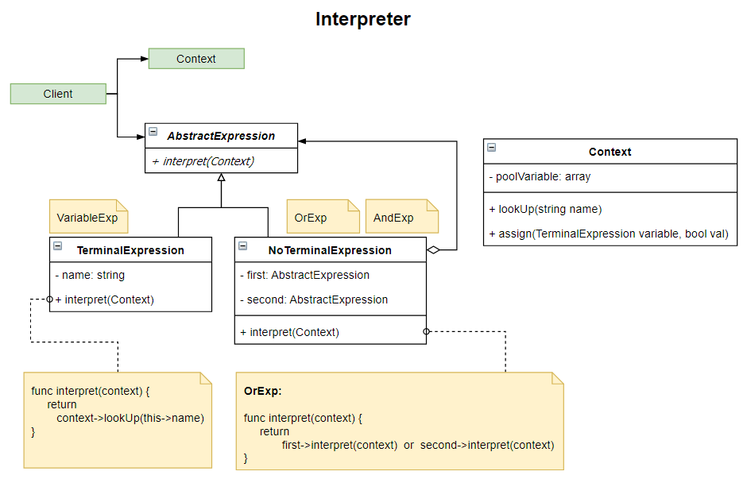

## Interpreter

## Intent

For a given language, the pattern describes its grammar using the terms Terminal Expression and Nonterminal
Expression, and defines an interpreter for sentences built with that language.

## Examples

    Interpreter of binary logic where each type of logical operation is defined in its own class.

## UML diagram

## Code

### AbstractExp.php

    <?php

    declare(strict_types=1);

    namespace DesignPatterns\Behavioral\Interpreter;

    abstract class AbstractExp

    {

        abstract public function interpret(Context $context): bool;

    }

### Context.php

    <?php

    declare(strict_types=1);

    namespace DesignPatterns\Behavioral\Interpreter;

    use Exception;

    class Context

    {

        private array $poolVariable;

        public function lookUp(string $name): bool

        {

            if (!key_exists($name, $this->poolVariable)) {

                throw new Exception("no exist variable: $name");

            }

            return $this->poolVariable[$name];

        }

        public function assign(VariableExp $variable, bool $val)

        {

            $this->poolVariable[$variable->getName()] = $val;

        }

    }

### VariableExp.php

    <?php

    declare(strict_types=1);

    namespace DesignPatterns\Behavioral\Interpreter;

    /**

    * This TerminalExpression

    */

    class VariableExp extends AbstractExp

    {

        public function __construct(private string $name)

        {

        }

        public function interpret(Context $context): bool

        {

            return $context->lookUp($this->name);

        }

        public function getName(): string

        {

            return $this->name;

        }

    }

### AndExp.php

    <?php

    declare(strict_types=1);

    namespace DesignPatterns\Behavioral\Interpreter;

    /**

    * This NonTerminalExpression

    */

    class AndExp extends AbstractExp

    {

        public function __construct(private AbstractExp $first, private AbstractExp $second)

        {

        }

        public function interpret(Context $context): bool

        {

            return $this->first->interpret($context) && $this->second->interpret($context);

        }

    }

### OrExp.php

    <?php

    declare(strict_types=1);

    namespace DesignPatterns\Behavioral\Interpreter;

    /**

    * This NonTerminalExpression

    */

    class OrExp extends AbstractExp

    {

        public function __construct(private AbstractExp $first, private AbstractExp $second)

        {

        }

        public function interpret(Context $context): bool

        {

            return $this->first->interpret($context) || $this->second->interpret($context);

        }

    }

## Test

### Tests/InterpreterTest.php

    <?php

    declare(strict_types=1);

    namespace DesignPatterns\Behavioral\Interpreter\Tests;

    use DesignPatterns\Behavioral\Interpreter\AndExp;

    use DesignPatterns\Behavioral\Interpreter\Context;

    use DesignPatterns\Behavioral\Interpreter\OrExp;

    use DesignPatterns\Behavioral\Interpreter\VariableExp;

    use PHPUnit\Framework\TestCase;

    class InterpreterTest extends TestCase

    {

        private Context $context;

        private VariableExp $a;

        private VariableExp $b;

        private VariableExp $c;

        public function setUp(): void

        {

            $this->context = new Context();

            $this->a = new VariableExp('A');

            $this->b = new VariableExp('B');

            $this->c = new VariableExp('C');

        }

        public function testOr()

        {

            $this->context->assign($this->a, false);

            $this->context->assign($this->b, false);

            $this->context->assign($this->c, true);

            // A OR B

            $exp1 = new OrExp($this->a, $this->b);

            $result1 = $exp1->interpret($this->context);

            $this->assertFalse($result1, 'A OR B must be false');

            // $exp1 OR C

            $exp2 = new OrExp($exp1, $this->c);

            $result2 = $exp2->interpret($this->context);

            $this->assertTrue($result2, '(A OR B) OR C must be true');

        }

        public function testAnd()

        {

            $this->context->assign($this->a, true);

            $this->context->assign($this->b, true);

            $this->context->assign($this->c, false);

            // A AND B

            $exp1 = new AndExp($this->a, $this->b);

            $result1 = $exp1->interpret($this->context);

            $this->assertTrue($result1, 'A AND B must be true');

            // $exp1 AND C

            $exp2 = new AndExp($exp1, $this->c);

            $result2 = $exp2->interpret($this->context);

            $this->assertFalse($result2, '(A AND B) AND C must be false');

        }

    }
