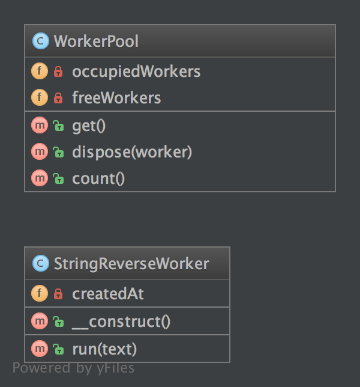

## Object Pool

A creational pattern that provides a set of pre-initialized objects ready for use (a pool), so you do not have to
create and destroy them each time.

Keeping objects in a pool can noticeably improve performance when the cost and speed of initialization is high, and
when the number of simultaneously used instances at any time is low. The time to obtain an object from the pool is
predictable, while creating a new object (especially with network overhead) can take an unpredictable amount of time.

However, these benefits mostly apply to objects that are expensive to create. For example, database connections, socket
connections, threads, or initialization of large graphical objects such as fonts or raster images. In some situations,
using a simple pool for objects that only consume memory and do not depend on external resources can be inefficient and
lead to reduced performance.

### Code

### WorkerPool.php

    <?php

    declare(strict_types=1);

    namespace DesignPatterns\Creational\Pool;

    use Countable;

    class WorkerPool implements Countable

    {

        /**

         * @var StringReverseWorker[]

         */

        private array $occupiedWorkers = [];

        /**

         * @var StringReverseWorker[]

         */

        private array $freeWorkers = [];

        public function get(): StringReverseWorker

        {

            if (count($this->freeWorkers) === 0) {

                $worker = new StringReverseWorker();

            } else {

                $worker = array_pop($this->freeWorkers);

            }

            $this->occupiedWorkers[spl_object_hash($worker)] = $worker;

            return $worker;

        }

        public function dispose(StringReverseWorker $worker): void

        {

            $key = spl_object_hash($worker);

            if (isset($this->occupiedWorkers[$key])) {

                unset($this->occupiedWorkers[$key]);

                $this->freeWorkers[$key] = $worker;

            }

        }

        public function count(): int

        {

            return count($this->occupiedWorkers) + count($this->freeWorkers);

        }

    }

### StringReverseWorker.php

    <?php

    declare(strict_types=1);

    namespace DesignPatterns\Creational\Pool;

    class StringReverseWorker

    {

        public function run(string $text): string

        {

            return strrev($text);

        }

    }

### PoolTest.php

    <?php

    declare(strict_types=1);

    namespace DesignPatterns\Creational\Pool\Tests;

    use DesignPatterns\Creational\Pool\WorkerPool;

    use PHPUnit\Framework\TestCase;

    class PoolTest extends TestCase

    {

        public function testCanGetNewInstancesWithGet()

        {

            $pool = new WorkerPool();

            $worker1 = $pool->get();

            $worker2 = $pool->get();

            $this->assertCount(2, $pool);

            $this->assertNotSame($worker1, $worker2);

        }

        public function testCanGetSameInstanceTwiceWhenDisposingItFirst()

        {

            $pool = new WorkerPool();

            $worker1 = $pool->get();

            $pool->dispose($worker1);

            $worker2 = $pool->get();

            $this->assertCount(1, $pool);

            $this->assertSame($worker1, $worker2);

        }

    }
