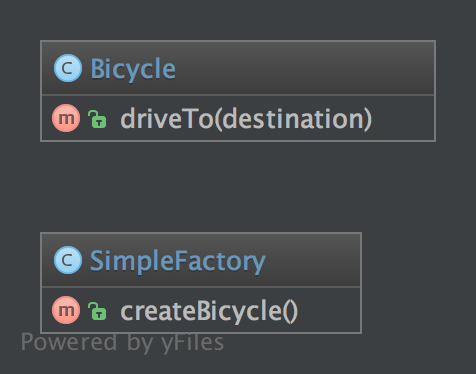

## Simple Factory

SimpleFactory in the example below is the "Simple Factory" pattern.

It differs from Static Factory in that it is not static. This means you can have multiple factories with different
parameters. Simple Factory should always be preferred over Static Factory.

## Code

### SimpleFactory.php

    <?php

    declare(strict_types=1);

    namespace DesignPatterns\Creational\SimpleFactory;

    class SimpleFactory

    {

        public function createBicycle(): Bicycle

        {

            return new Bicycle();

        }

    }

### Bicycle.php

    <?php

    declare(strict_types=1);

    namespace DesignPatterns\Creational\SimpleFactory;

    class Bicycle

    {

        public function driveTo(string $destination)

        {

        }

    }

### Usage

    $factory = new SimpleFactory();

    $bicycle = $factory->createBicycle();

    $bicycle->driveTo('Paris');

### SimpleFactoryTest.php

    <?php

    declare(strict_types=1);

    namespace DesignPatterns\Creational\SimpleFactory\Tests;

    use DesignPatterns\Creational\SimpleFactory\Bicycle;

    use DesignPatterns\Creational\SimpleFactory\SimpleFactory;

    use PHPUnit\Framework\TestCase;

    class SimpleFactoryTest extends TestCase

    {

        public function testCanCreateBicycle()

        {

            $bicycle = (new SimpleFactory())->createBicycle();

            $this->assertInstanceOf(Bicycle::class, $bicycle);

        }

    }
