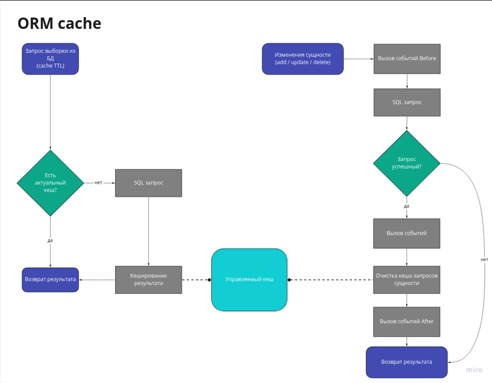
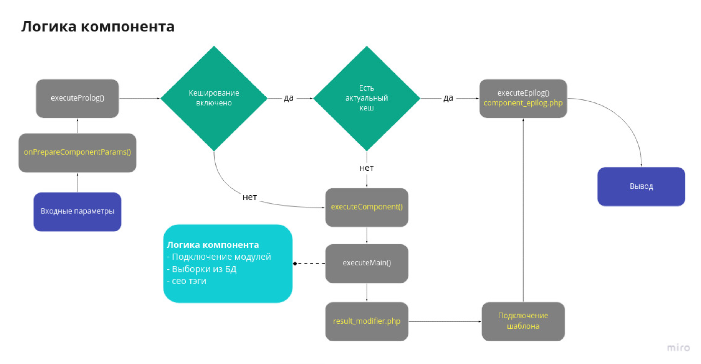

# Bitrix

#### Links

- [Everything about caching in Bitrix: D7, tagged cache, cache in components](https://r-morozov.ru/bitrix/vsjo-o-keshirovanii-v-bitriks-d7-tegirovannyj-kesh-kesh-v-komponentah/)
- [Phinx migrations in Bitrix](https://varnote.ru/posts/php/bitrix-phinx/)
- [Bitrix24 integration with a site - all methods](https://bit-24.ru/blog/integratsii-bitriks24/bitrix24-integration-with-the-site-all-the-ways/)

## Checklist [&uarr;](#bitrix)

- [ ] [Patterns in Bitrix](#patterns-in-bitrix)
- [ ] [Project structure: folders, init.php, local/](#project-structure-folders-initphp-local)
- [ ] [MVC in Bitrix and other CMSs](#mvc-in-bitrix-and-other-cmss)
- [ ] [Custom module, custom component](#custom-module-custom-component)
- [ ] [Caching in Bitrix](#caching-in-bitrix)
- [ ] [Component execution order: component, result_modifier, template, cache, component_epilog](#component-execution-order-component-result_modifier-template-cache-component_epilog)
- [ ] [b_event table](#b_event-table)
- [ ] [D7 Bitrix: what is fundamentally new](#d7-bitrix-what-is-fundamentally-new)
- [ ] [Access control: can you set access to a specific iblock element](#access-control-can-you-set-access-to-a-specific-iblock-element)
- [ ] [Site performance optimization](#site-performance-optimization)
- [ ] [Migrations](#migrations)
- [ ] [Bitrix24 integration](#bitrix24-integration)
- [ ] [HL blocks](#hl-blocks)
- [ ] [Sphinx](#sphinx)
- [ ] [Multisite](#multisite)
- [ ] [Composite site](#composite-site)
- [ ] [Scaling module](#scaling-module)
- [ ] [Cluster systems](#cluster-systems)

1C-Bitrix is built on Bitrix Framework. It is often said to be based on Zend Framework; the official docs mention it only
briefly. The framework follows MVC, is written in PHP, and supports MySQL, Oracle, and MS SQL.

Logically, 1C-Bitrix can be split into:

- Modules
- Components
- Template

## Patterns in Bitrix [&uarr;](#bitrix)

- `Observer`

  We often use event handlers in Bitrix, attach them to iblocks and other objects. This is very similar to observer. The
  classic observer is more limited because it does not know which event fired. Another candidate for this role is the
  event dispatcher.

- `Singleton`

  Strict singleton is not implemented in Bitrix, but the global variables `$APPLICATION` and `$DB` are strong candidates.

- `MVC (Model-View-Controller)`

  We all know this one. We were taught that web apps must follow MVC. I agree. In Bitrix, MVC is components 2.0. The
  component is the controller, the template is the view, and modules are the model.

- `Front controller (single entry point)`

  This is my favorite pattern. It is not present in Bitrix, but if you imagine a global complex component for the whole
  site, it could be called a front controller.

- `Adapter`

  `$DB` is essentially an adapter. We plug in a specific implementation for a specific database, while all
  implementations share one interface.

- `Decorator`

  Components 2.0 are also a bit like decorators. We can change a component's behavior outside the component itself, for
  example in the component epilog. A decorator expects two objects, and in our case the component and epilog are not
  objects, but there is still a common idea.

It is worth noting that Bitrix implements these patterns in a non-obvious way. I might have missed others. Also, if you
believe the Bitrix manual, components 2.0 implement the Carrier Rider Mapper pattern. I did not grasp its essence, so
for me it is just MVC.

## Project structure: folders, init.php, local/ [&uarr;](#bitrix)

The whole system lives in `/bitrix/`. It includes the following subdirectories and files:

- `/admin/` - admin scripts
- `/cache/` - cache files
- `/components/` - system and custom components
- `/js/` - JavaScript files for modules
- `/managed_cache/` - managed cache
- `/modules/` - system modules, each subdirectory has a strict structure
- `/php_interface/` - service directory that includes:
  - `dbconn.php` - DB connection settings
  - `init.php` - additional portal parameters
  - `after_connect.php` - runs right after connecting to the DB
  - `dbconn_error.php` - runs on DB connection error
  - `dbquery_error.php` - runs on SQL query error
  - `/SITE_ID/init.php` - additional site parameters, loaded right after the special constant SITE_ID is defined
- `/templates/` - site and component templates, includes:
  - `/.default/` - common files used by a default template; structure matches the structure below
  - `/TEMPLATE_ID/` - site template directory, includes:
    - `/components/` - customized component templates
    - `/lang/` - language files for the template and its components
    - `/images/` - template images
    - `/page_templates/` - page templates and their descriptions in `.content.php`; when a user creates a new page they
      choose a template from this directory
    - `header.php` - template prolog
    - `footer.php` - template epilog
    - `template_styles.css` - main CSS file for the template
    - `styles.css` - CSS styles for the visual editor (Site styles tab)
- `header.php` - standard file that includes the current template prolog; must be used on all public pages
- `footer.php` - standard file that includes the current template epilog; must be used on all public pages
- `license_key.php` - license key file

## MVC in Bitrix and other CMSs [&uarr;](#bitrix)

Comparing 1C-Bitrix to the Model-View-Controller pattern:

- A module in 1C-Bitrix is the model in MVC.
- A component in 1C-Bitrix is both the controller and the view in MVC (the component uses APIs of one or more modules to
  manipulate data, and the component template (the view) renders the data on the page).
- A template in 1C-Bitrix is a pure view in MVC (it controls the appearance, not the content).

P.S. This division is conditional, because Bitrix does not follow MVC strictly enough, in my opinion. Start with
modules.

Modules are located in `/bitrix/modules/`. Each module provides an API for a specific function across the CMS. Examples:
store and render articles, news, photo galleries (Information blocks module); build an online store (Online store
module); manage product pricing and integrate the store with 1C:Enterprise and services like Yandex.Market (Catalog
module); build a blog (Blogs module), forum (Forum module), and so on. These APIs are used by other modules and by
components.

## Custom module, custom component [&uarr;](#bitrix)

Module files live in `/bitrix/modules/MODULE_ID/`. Directory structure:

- `admin/` - module admin scripts
  - `menu.php` - module admin menu
- `classes/` - module classes
  - `general/` - classes independent of the DB
  - `mysql/` - classes for MySQL
  - `mssql/` - classes for MS SQL
  - `oracle/` - classes for Oracle
- `lang/LANG_ID/` - language files for module scripts
- `lib/` - files (API: classes, logic) for the new D7 core (may be absent)
- `install/` - files used to install and uninstall the module
  - `admin/` - scripts that include the module admin scripts (caller scripts)
  - `js/` - module JS scripts, copied to `/bitrix/js/MODULE_ID/`
  - `db/` - SQL scripts for install/uninstall
    - `mysql/` - SQL scripts for MySQL
    - `mssql/` - SQL scripts for MS SQL
    - `oracle/` - SQL scripts for Oracle
  - `images/` - images used by the module; after install they should be copied to `/bitrix/images/MODULE_ID/`
  - `templates/` - module components 1.0 (kept only for compatibility)
    - `MODULE_ID/` - component files
    - `lang/LANG_ID/MODULE_ID/` - language files for module components
  - `components/NAMESPACE/COMPONENT_NAME/` - module components 2.0
  - `themes/MODULE_NAME/` - CSS and images for admin panel styles if the module needs them (deprecated, pre-12.0)
  - `panel/MODULE_NAME/` - CSS and images for admin panel styles if the module needs them
  - `index.php` - module description
  - `version.php` - module version; version cannot be zero
- `include.php` - included when the module is loaded; should include all function and class libraries
- `default_option.php` - contains the `$MODULE_ID_default_option` array with default module parameters

Note: for partner modules with a dot in the name (example: `mycompany.forum`), the dot is replaced with an underscore in
variable names.

- `options.php` - included on the module settings page in the admin menu
- `prolog.php` - can be included in all admin scripts; usually defines the `ADMIN_MODULE_NAME` constant
- `.settings.php` - module settings file read via
  `\Bitrix\Main\Config\Configuration::getInstance($module)`

Component logic and rendering live in two files:

- Controller: `www/bitrix/components/bitrix/COMPONENT_NAME/component.php`
- View (component template):
  `www/bitrix/components/bitrix/COMPONENT_NAME/templates/TEMPLATE_NAME/template.php`

The official docs describe component behavior well; I will repeat their wording: the component (its controller) uses API
of one or more modules to manipulate data, and the component template renders the data on the page.

A component can have multiple templates, one of which is active (specified when calling the component).

Besides controller and view, a component has supporting files: a help file, a logo for the admin panel, a component
description for the admin panel, and so on.

Typical component structure:

- `help/` - component help files (hints in component settings)
- `images/` - images used by the component
- `lang/` - language files
- `templates/` - templates (views)
- `.description.php` - component description
- `.parameters.php` - component input parameters (used by the config window)
- `component.php` - main component logic (controller)

## Caching in Bitrix [&uarr;](#bitrix)

Simple caching: `CPhpCache` is a class for caching PHP variables and HTML output from a script.

Tagged cache: `RegisterTag`.



## Component execution order: component, result_modifier, template, cache, component_epilog [&uarr;](#bitrix)



## b_event table [&uarr;](#bitrix)

Sometimes a site has issues sending mail. Before fixing the error, check the queue of emails that were not sent.

If you fix the mail error and do not clear the queue (for example 3000 emails), all of those will start sending, and
visitors will wonder, "Why did I get an order email from a month ago?"

The mail queue in Bitrix is stored in the `b_event` table. Admin path: Settings, Performance, Tables.

If the `DATE_EXEC` field is empty, the email has not been processed by the mail server yet.

To delete these emails, run an SQL query. Go to Settings, Tools, SQL query.

Run:

```
DELETE FROM `b_event`
```

After this, the table will be empty, and no stray emails will be sent.

## D7 Bitrix: what is fundamentally new [&uarr;](#bitrix)

In the new core:

- page lifecycle changed
- team development simplified and made more convenient
- error and exception handling added
- a unified class library for service functions
- improved support for modern IDEs
- components can use OOP
- global variables abandoned
- single-page template
- fast pages for AJAX interfaces

### New ORM

A key tool appeared: ORM (object-relational mapping), which lets you structure data and access it via a single interface
(`getList`, `add`, `update`, and so on).

### Highload info blocks module

The Highload Info Blocks module, built on ORM with NoSQL support, distributes load and helps find data quickly without
slowing the site, which is important for high-traffic resources.

Features of the module:

- The module lets you create lists to store arbitrary data (news, vacancies). Each list lives in its own DB table:
  - performance via data split across tables
  - unified and efficient API via the new ORM
  - user fields
- Admin pages:
  - create or edit lists (tables are created, fields and indexes are modified)
  - edit list elements
- Universal components

### Class library

The new version includes a class library with categorized functions. This significantly simplifies and speeds up site
creation and management.

### Migration to the new core

When creating a site, you can use both the old and new cores. Migration to the new core happens gradually, without
breaking running sites. Detailed instructions are provided for migrating to the new core.

## Access control: can you set access to a specific iblock element [&uarr;](#bitrix)

1) If a separate group is needed for a user, create it here: Settings -> Users -> User groups -> Add group.

   1.1) In the Parameters tab, set the group name and symbolic code.

   1.2) In the Access tab, configure access to project modules. Some custom modules might be missing from the list. In
   that case, a developer must adjust the module code:

        1.2.1) In `/admin/menu.php` add a check for the user access level for the module. If access is insufficient, the
        module will not appear in the menu. Example:
        `if ($GLOBALS['APPLICATION']->GetUserRight('module.id') < 'R') { return []; }`

        1.2.2) Allow admins to set access level for the module. In `/install/index.php` add this variable to the installer
        class: `public $MODULE_GROUP_RIGHTS = 'Y';`

2) Create a new user here: Settings -> Users -> User list -> Add user.

   2.1) On the User tab, set Email, Login, password, and password confirmation.
   2.2) On the Groups tab, attach the user to the required group.

3) If a new user group was created:

   3.1) Content -> Files and folders -> Bitrix: grant the group access to `/admin/`. Open the folder settings
   (context menu -> Product access rights) and grant read access. Otherwise the user cannot log in.

   3.2) If you need access to the Media Library: Content -> Media library -> Access. Grant read or write access for the
   group.

4) If you need to grant the new user cache clean-up rights:

   4.1) Create a new access level here: Settings -> Users -> Access levels -> Add access level. Then:
   4.1.1) Field Name: set any descriptive access level name.
   4.1.2) Field Module: choose Main module.
   4.1.3) Field Letter: set the letter R.
   4.1.4) Field Description: add a description if needed.
   4.1.5) In the Enabled operations tab, enable several checkboxes (and others if needed):
   - View own profile (`view_own_profile`)
   - Edit own profile (`edit_own_profile`)
   - Cache management (`cache_control`)

   4.2) If this access level already exists, skip 4.1.
   4.3) Go to the Access tab in the group settings (see 1.2) and for Main module pick the new access level from 4.1.

5) If the project uses iblocks:

   5.1) Open the iblock settings: Content -> Iblocks -> Iblock types -> Iblock name.
   5.2) On the Access tab, configure group access to the iblock. Do this for every iblock that requires access control.

## Site performance optimization [&uarr;](#bitrix)

Different frameworks and CMSs provide different debug panels. In Bitrix you can test performance in the admin panel:
`/bitrix/admin/perfmon_panel.php?lang=ru`. The test result shows the most loaded pages, their average load time, and the
number of queries per hit.

Optimize each loaded page, sorting by query count and execution time:

- Remove queries from loops (example below).
- In the `select` array, keep only fields used by the script.
- If query time exceeds 0.001 seconds, optimize the query and consider adding indexes.
- Check that caching is configured and its parameters are correct.
- In Bitrix you can use the proprietary Auto Composite technology, which stores generated page copies in
  `/bitrix/html_pages/` and serves them while loading dynamic content in the background. As a result, pages are served
  instantly to users.

## Migrations [&uarr;](#bitrix)

Almost every modern PHP framework has its own migration system. In Bitrix, there is no built-in way to modify the DB
structure except through the admin panel.

Phinx was chosen for these reasons:

- It is not tied to a framework and can work as a standalone module.
- It separates structure migrations from data migrations (seeder).
- It has a convenient builder and allows using Bitrix ORM in migrations.
- The entire setup is in a single PHP file.

## Bitrix24 integration [&uarr;](#bitrix)

Types of integration for site requests and leads into Bitrix24:

- Integration via Bitrix24 CRM forms
- Integration via REST API
- Integration between a Bitrix site and Bitrix24
- Integration via email service (last resort)
- Integration between CRM forms and a site built with a site builder
- Bitrix24 integration with a Bitrix online store
- Bitrix24 integration with an online store on another CMS

## HL blocks [&uarr;](#bitrix)

https://dev.1c-bitrix.ru/learning/course/index.php?COURSE_ID=43&CHAPTER_ID=05745

Because the Information Blocks module is considered "heavy" for lightweight directories or large data storage (it can be
slow), there was a need for an analog of iblocks: the Highload Blocks module. It is much simpler and "lighter". The new
module has been available since product version 14.0 and is written on the new D7 core. The data structure of this
module assumes use in high-load projects.

Note: Highload blocks and traditional iblocks are different things. You cannot convert traditional iblocks into
highload blocks. It is like converting a forum to a wiki. Technically you can build a similar structure and move the
data, but it only makes sense for a specific project with a specific need.

Highload blocks are fast directories without hierarchy support and with limited property support. They can access the
DB (including via HandlerSocket) and work with large data volumes. Highload blocks store elements in their own tables
and use their own indexes.

## Sphinx [&uarr;](#bitrix)

https://dev.1c-bitrix.ru/learning/course/?COURSE_ID=35&LESSON_ID=5935&LESSON_PATH=3906.4507.5935

External full-text search with Sphinx makes site search fast and high quality and reduces server load. It is available
in 1C-Bitrix products since version 14.0.0 and is fully integrated with Search module components.

## Multisite [&uarr;](#bitrix)

https://dev.1c-bitrix.ru/learning/course/?COURSE_ID=103&LESSON_ID=287

## Composite site [&uarr;](#bitrix)

https://habr.com/ru/post/325926/

In short, composite site technology is an improved version of HTML caching.

In an HTML template you can separate areas of static and dynamic content. This gives users instant access to selected
information on pages. Static content is a page area seen by all visitors. Dynamic content is shown individually for each
visitor. Dynamic content can include a login form, cart, banners, and so on.

With a composite site, static content loads instantly. The visitor sees the static area immediately and can continue to
read and act. The dynamic area loads gradually in the background and is cached in the browser.

How to enable composite site technology:

First, check which 1C-Bitrix version your site uses. Composite site technology is available from version 14.5 and higher.
If you have an earlier version, update to the latest or buy a renewal.

Go to Product settings. There you will see the Composite site item. Just enabling it is not enough. You need to adapt
specific pages for composite site. Each template element must be adapted. If at least one component is not adapted, the
technology will not work on the page.

To configure the static area on a page, add this line to the template:

```
$this->setFrameMode(true);
```

To define dynamic areas, use:

```
$frame = $this->createFrame()->begin();
$frame->end();
```

## Scaling module [&uarr;](#bitrix)

https://dev.1c-bitrix.ru/learning/course/index.php?COURSE_ID=48&CHAPTER_ID=06644&LESSON_PATH=3918.4635.6644

## Cluster systems [&uarr;](#bitrix)

https://dev.1c-bitrix.ru/learning/course/index.php?COURSE_ID=35&LESSON_ID=3018&LESSON_PATH=3906.6663.4750.3018
