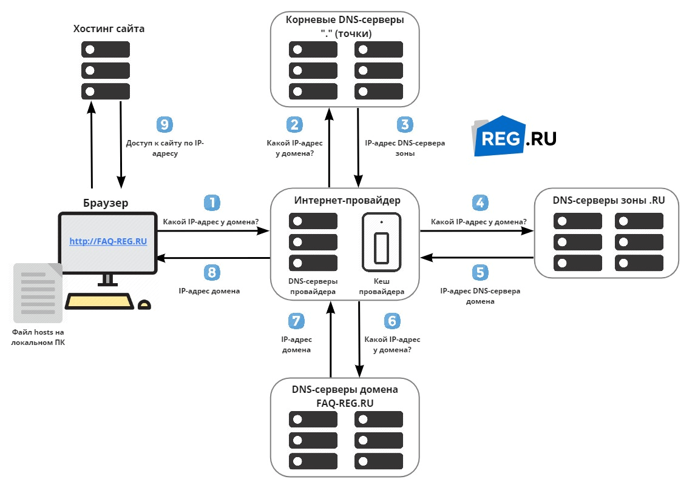

# Internet

#### Links

- [Networking basics](https://doka.guide/tools/network/)
- [URL](https://doka.guide/tools/url/)
- [HTTP protocol](https://doka.guide/tools/http-protocol/)
- [TCP and UDP protocols](https://doka.guide/tools/tcp-udp-protocols/)
- [What is an email protocol](https://emailsoldiers.ru/glossary/email-protocol)
- [ORM (Object-Relation Mapping)](https://ru.hexlet.io/courses/php-orm-eloquent/lessons/concepts/theory_unit)
- [Doctrine](https://ru.wikipedia.org/wiki/Doctrine)
- [DesignPatternsPHP](https://designpatternsphp.readthedocs.io/ru/latest/README.html)
- [ActiveRecord](https://ru.wikipedia.org/wiki/ActiveRecord)
- [Doctrine ResultSetMapping examples](https://habr.com/ru/post/496166/)
- [Prepared statements and stored procedures](https://www.php.net/manual/ru/pdo.prepared-statements.php)
- [How to work with PDO? Full guide](https://phpfaq.ru/pdo)

## How the Internet Works [&uarr;](#internet)

The Internet is a global information system that:

- is logically linked by a global space of unique addresses based on the Internet Protocol (IP);
- supports communication using the TCP/IP protocol suite and/or other IP-compatible protocols;
- provides and makes available high-level services built on top of this communication infrastructure.

## Types of Network Protocols [&uarr;](#internet)

### IP - Internet Protocol

IP is a transport protocol that first connected separate computers into a single network. It is the most basic protocol
in this list. It is unreliable because it does not confirm packet delivery or check data integrity. IP transfers data
without establishing a connection.

The main task of this protocol is datagram routing: determining the path of data across network nodes.

The most common version today is IPv4 with 32-bit addresses, which allows about 4.29 billion IPv4 addresses. This is a
large but finite number. IPv6 solves this by providing 2^128 unique addresses.

### TCP/IP - Transmission Control Protocol/Internet Protocol

This is a stack of the TCP and IP protocols. TCP provides reliable transport and ensures data integrity. IP handles
routing. TCP is often used by higher-level protocols.

### UDP - User Datagram Protocol

UDP transfers data without establishing a connection. It is unreliable: packets may be lost, arrive out of order, or be
duplicated.

The main advantage of UDP is speed. Applications sensitive to network latency often use UDP.

### FTP - File Transfer Protocol

FTP is a file transfer protocol used since 1971, long before IP. Today it is used for remote access to hosting servers.
FTP is reliable and guarantees delivery.

It follows a client-server model. Users authenticate (sometimes anonymously) and gain access to the server file system.

### DNS

DNS is both a domain name system and a protocol. It allows client machines to request an IP address for a website and
supports database exchanges between DNS servers. DNS uses both TCP and UDP.

### HTTP - HyperText Transfer Protocol

Originally created for HTML document transfer, HTTP now carries arbitrary data on the internet. It is a stateless
client-server protocol. The client is usually a web browser, but can also be a crawler. HTTP usually runs over TCP/IP.

HTTP has an extension called HTTPS that adds encryption using TLS.

### HTTPS

HTTPS is not a separate protocol. It is HTTP combined with SSL or TLS.

TLS (Transport Layer Security) and SSL (Secure Socket Layer) are cryptographic protocols. They encrypt data between the
browser and server so only the endpoints can read it.

Note: TLS is based on SSL, but SSL is obsolete and replaced by TLS.

### TLS

TLS is a cryptographic protocol that provides secure data transfer between nodes on the internet. It uses asymmetric
encryption for authentication, symmetric encryption for confidentiality, and message authentication codes for integrity.
TLS is widely used by web browsers, email, instant messaging, and VoIP.

TLS evolved from SSL, but is more secure. TLS 1.2 is recommended instead of SSL 3.0, which was deprecated in RFC 7568 in
June 2015. TLS 1.3 was standardized in RFC 8446 in August 2018.

### SSL

SSL is a cryptographic protocol that provides a secure communication channel between two devices on the internet or a
local network. It protects sensitive data such as credit card numbers, usernames, and passwords.

SSL creates a secure connection that ensures confidentiality, integrity, and authenticity. It provides:

    Encryption: protection of data transfer (browser to server, server to server, app to server, etc.).
    Authentication: verification of server and client identity.
    Integrity: assurance that data was not modified in transit.

SSL certificates are data files that bind an encryption key to company information. SSL certificates are used for secure
credit card transactions, data transfer, and password-protected logins.

You can check whether a site uses SSL by looking for a lock icon in the browser address bar and inspecting the
certificate details.

### NTP - Network Time Protocol

NTP synchronizes local device time with network time. It uses the Marzullo algorithm to select the most accurate time
source. NTP runs over UDP, which makes it fast and resilient to network delays.

NTPv4 can reach about 10 ms accuracy on the internet and 0.2 ms in local networks.

### SSH - Secure SHell

SSH is a protocol for remote OS administration over TCP. It encrypts all traffic with a choice of algorithms, which is
critical for passwords and sensitive data.

SSH can also tunnel other protocols, so it can carry files and even audio/video streams.

SSH is commonly used for hosting servers where clients connect remotely and work on the server directly.

## Email Protocols [&uarr;](#internet)

Email protocols define how a sender's mail system communicates with a recipient's mail system.

There are three main protocols: IMAP, POP3, and SMTP. HTTP is not an email protocol, but it can be used to access a web
mail interface.

SMTP is best for sending mass emails. POP3 is useful when mail server storage is limited. IMAP is preferred when you
need to sync email across multiple devices.

### POP3

POP3 does not keep messages on the server. It downloads copies to devices (computer, laptop, phone) and then removes
the originals. Once deleted, messages cannot be re-downloaded.

Downloaded emails are available offline, which is useful when connectivity is limited.

POP3 has a simple interface. It responds with OK (all good) or ERR (error).

It uses two ports: 110 for unencrypted mail and 995 for encrypted mail.

Flow:

    The recipient connects to the server via port 110 or 995.
    Downloads all new messages to the device.
    Reads messages and deletes unnecessary ones.
    Disconnects from the incoming server.

### IMAP

With IMAP, messages stay on the server. You can read email without downloading it from any device connected to the
internet.

IMAP only downloads messages when you open them. You can filter and download only what you need. The device usually
downloads just the message body; attachments require an internet connection.

IMAP uses flags to mark messages as read, important, recent, and so on. Examples:

    \seen - message read
    \answered - replied to
    \draft - draft message
    \flagged - marked as urgent

Ports:

Port 143 is the default for unencrypted mail. Port 993 is used for secure connections.

Flow:

    The recipient server tells the sender server it is ready to receive mail.
    The sender authenticates in the mail client with username and password.
    The sender server confirms authentication.
    The user selects a mailbox folder.
    The server receives the folder selection and can perform mailbox actions.

### SMTP

SMTP is used to send messages between sender and recipient servers. It uses a specific set of commands to accept mail.

SMTP can only transmit text in the message body. Images must be attached as files.

Before sending, SMTP establishes a connection with the recipient, which helps deliver quickly. If delivery fails, the
sender receives an error report.

Commands:

    HELO - starts a dialog between sender and receiver
    EHLO - indicates use of extended SMTP
    MAIL FROM - sender address
    RCPT TO - recipient address
    VRFY - verify whether a user exists on the receiving server

Ports:

SMTP uses port 25 by default. For unencrypted mail, port 2525. For secure mail, port 465.

Flow:

    The recipient server checks sender settings and allows sending.
    The sender server connects to the recipient server and sends the email.
    The recipient server confirms delivery or returns an error.

### HTTP

HTTP is used for data exchange on the internet. It is not an email protocol, but it can provide access to web mail.

HTTP flow:

    The browser requests the HTML document for the mail page.
    The browser parses the HTML and requests additional files (scripts, styles, assets).
    The browser combines everything into a single web page.

Hotmail is an example of email over HTTP.

Which email protocol to choose:

SMTP is best for mass email delivery. Otherwise, choose between POP3 and IMAP.

If mail server storage is limited, POP3 is better because messages are removed from the server once downloaded.

If you need to sync mail across devices, IMAP is the better choice.

## How a Browser Works [&uarr;](#internet)

### 1. The user enters a website address in the browser

### 2. The browser locates the server

Every website is hosted on a server connected to the internet. The server has a unique IP address, for example
85.119.149.83 for vc.ru.

So the browser must find the IP address of the server that hosts the site.

This information is stored in DNS (Domain Name System), a distributed system that acts like a global contact book.

Before querying DNS, the browser checks local caches to save time:

    Browser history and DNS cache from previous visits.
    The operating system cache (for example, if the site was accessed by another app).
    The router cache, which stores recent connections from the local network.

### 3. The browser queries DNS servers

If no cached record is found, the browser queries DNS servers on the internet.

For example, to find mail.vc.ru, the browser asks a DNS server for its IP address.

The server may reply: "I do not know mail.vc.ru, but I know the server responsible for vc.ru." The request is forwarded
up the chain until a server returns the IP address for the site.

### 4. The browser establishes a connection

Once the browser has the IP address, it establishes a connection, usually via TCP.

TCP defines connection rules, request formats, and behavior on data loss.

TCP uses a three-way handshake:

    The client sends a SYN packet to start a connection.
    The server responds with a SYN/ACK packet.
    The client responds with an ACK packet. The connection is established.

### 5. The browser sends an HTTP request

After connecting, the browser sends a request for the page content. The request includes browser info, temporary data,
connection requirements, and more.

The browser must specify exactly what data it needs.

There are two main request types:

    GET for retrieving data (images, text, video).
    POST for sending data (messages, uploads).

Most sites use HTTPS, which encrypts the connection and uses a certificate to verify security.

### 6. The server processes the request

The server receives the request and processes it. This is done by web server software such as nginx or Apache.

The web server forwards the request to an application (PHP, Ruby, ASP.NET, etc.), which generates the response.

### 7. The server sends the response

When the response is ready, the server sends it back. The response includes the page content, compression details,
caching instructions, cookies, and more.

To keep data exchange fast, browsers and servers send many small packets, typically around 8 KB each. Packets are
numbered to keep sequence.

### 8. The browser renders the page

The browser unpacks the response and starts rendering the page.

It loads the HTML structure first, then requests additional resources (images, scripts, styles). As the page loads, the
browser and server keep exchanging data.

The browser often caches static files so that repeat visits load faster.

When rendering finishes, the user sees the fully loaded page.

## Hosting [&uarr;](#internet)

Hosting is a service that places a website or other content on a server with continuous internet access.

A website is a set of files that must be stored somewhere. A home computer is not a good option: it would require
24/7 uptime, a fast and stable connection, and electricity costs. Home hardware is also not designed for heavy traffic.

So website owners usually rent space on a server from a hosting provider. The provider ensures server uptime,
maintenance, and security.

Types of hosting:

- shared (many sites on one server with resource limits);
- virtual private server (multiple virtual servers on one physical host with more customization but shared resources);
- dedicated server (a whole server with its own software and OS);
- colocation (placing your own server at a hosting provider).

## Domain Names [&uarr;](#internet)

A domain is the site name and address on the internet. It is also called a domain name or domain address. Users type a
domain into the browser, and the server maps it to the correct site.

The purpose of a domain name is to make a site easier to remember. Short, memorable names work best. If a site is moved
from one server to another, its IP address changes but the domain stays the same.

Domains are also used for:

- Email setup. For example, with company.com you can use contact@company.com and send bulk emails.
- Parking. You can register a domain and show a banner while the site is under development.
- Redirects. If a domain changes after a redesign, redirects send users from the old site to the new one.

Domain names are hierarchical. A third-level domain is built on a second-level domain, which is built on a top-level
domain.

- Second-level domain (or subdomain) is the part to the left of the dot: youtube.com, shop.reg.ru.
- Top-level domain (TLD) is the part to the right of the dot. This is controlled by ICANN. TLDs can be geographic
  (.RU, .EU, .AC) or thematic (.COM, .BIZ, and newer gTLDs like .FLOWERS, .HEALTH, etc.).
- Root domain is the dot after the TLD (reg.ru.), which is not shown in the address bar.

### Domains in DNS

You can think of the domain hierarchy as nested dolls: a third-level domain (music.youtube.com) is inside a second-level
domain (youtube.com), which is inside a top-level domain. All are inside the root (dot).

This hierarchy enables DNS.

## DNS [&uarr;](#internet)

The internet is a huge number of physical devices (servers, computers, tablets, etc.) connected in a network. Every
site runs on a physical device with a unique IP address such as 123.123.123.123.

To access a site, you need its IP address. Remembering all those numbers is impossible. DNS (Domain Name System) was
created to map IP addresses to readable domain names. For example, IP 194.58.116.30 maps to reg.ru. When you enter a
name, DNS resolves it to the IP address, and you reach the site.

DNS lets the browser find a site by its domain name.

### How DNS servers work

### Why you need to set DNS servers for a domain

When you register a domain, nobody else knows it exists. To make it visible, you must set DNS servers for the domain.
These servers tell the rest of the DNS system about your domain.

### Types of DNS records

DNS stores mappings between domain names and IP addresses in zone files. Common record types:

    A - IP address of a web resource for the domain name
    MX - mail server address
    CNAME - alias for the main domain name (often used for subdomains)
    NS - DNS server address where resource records are stored
    TXT - arbitrary text info about the domain
    SPF - list of servers allowed to send mail on behalf of the domain
    SOA - start of authority record with zone server details

### Why domains do not work immediately

DNS caches refresh once per day. If you update DNS servers, you may need to wait up to 24 hours. DNS changes can cause a
temporary outage until caches update.

## Proxy Servers [&uarr;](#internet)

A proxy server is a middle layer between you and the internet. It makes the destination site think the proxy is the
real client.

Proxies are used for:

    - Privacy: hiding who visits a site.
    - Security: basic attacks hit the proxy first.
    - Access to location-restricted content.
    - Faster access to some resources.
    - Access to blocked content.

A proxy replaces your IP and routes traffic through an intermediate server that may cache data or apply extra security.

Since proxies are about IP substitution, note why that matters:

    - The IP address reveals your location to sites and apps.
    - IPs are used to block access by geography.

So people use proxies to avoid blocks and reduce visibility. Some proxies do disclose user data to sites and are used
only for performance.

A VPN provides more privacy and security than a proxy because it encrypts traffic and routes it through a secure VPN
server. A proxy simply forwards traffic through an intermediary server, without necessarily adding protection.
