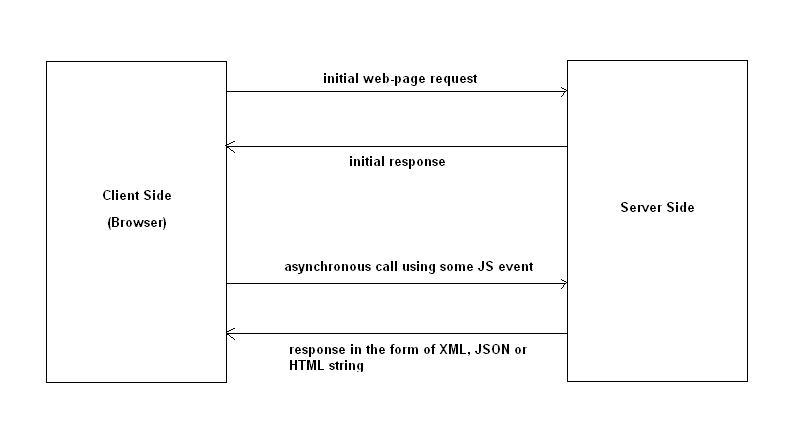

# JavaScript

## JavaScript Fundamentals [&uarr;](#javascript)

Get familiar with:

- Variables
- Data types
- Functions
- Recursion
- Closures
- Scope
- Objects
- Events
- DOM

## Responsive Web Design [&uarr;](#javascript)

Learn the concepts:

- Adaptive web design
- Responsive web design
- Media queries
- Mobile first
- Graceful degradation
- RESS

## JavaScript Libraries [&uarr;](#javascript)

Goal: get familiar with popular JavaScript libraries and know where and when to use them.

List:

- jQuery
- ReactJS
- Underscore - a set of useful functions
- Modernizr - detects HTML5 and CSS3 features in the user's browser
- Babel - a compiler for next-generation JavaScript
- Three - 3D
- WOW - animation on scroll
- Moment - date and time handling
- Mocha - writing tests

## CSS Preprocessors [&uarr;](#javascript)

Learn the concepts:

- Variables
- Mixins
- Functions
- Imports
- Minification

List of CSS preprocessors:

- Sass/Scss
- Less
- Stylus

## Build Tools [&uarr;](#javascript)

A build tool is a small application used to automate tedious and repetitive tasks in project development. These tasks
include running unit tests, concatenating files, minifying, and preprocessing CSS.

Build tools:

- Gulp
- Grunt
- Webpack
- Vite

## Package Managers [&uarr;](#javascript)

List of package managers:

- Bower
- npm
- Yarn

## CSS Frameworks [&uarr;](#javascript)

List of frameworks:

- Bootstrap
- Skeleton
- Foundation

## JavaScript Frameworks [&uarr;](#javascript)

There are many frameworks, and you do not need to learn everything at once. Pick a few as a baseline.

List of frameworks:

- Angular
- Vue
- Svelte
- Ember

## Single-Page Applications (SPA) [&uarr;](#javascript)

A single-page application (SPA) is a site or web app that uses a single HTML document as a shell for all pages and
organizes user interaction through dynamically loaded HTML, CSS, and JavaScript, usually via AJAX.

Study:

- JavaScript frameworks
- Routing
- Templating
- APIs, for example REST
- AJAX

## Topics to Revisit [&uarr;](#javascript)

- Fundamentals review: scope, closures, OOP, regular expressions
- Vanilla JS (selectors, events)
- Framework refresh: Vue
- Realtime patterns: long polling, short polling, server-sent events

## Ajax [&uarr;](#javascript)

AJAX stands for Asynchronous JavaScript and XML and allows asynchronous fetching of content from a server without
reloading the page. It lets you update parts of a page without a full refresh.

A typical AJAX call works like this:

A typical AJAX flow:

1. The user opens a web page with a normal synchronous request.
2. The user clicks a DOM element, usually a button or a link, which triggers an asynchronous request to the server.
   The end user does not notice because the call is asynchronous and does not refresh the browser. You can detect these
   calls with a tool like Firebug.
3. The server returns XML, JSON, or HTML data.
4. The response data is processed with JavaScript.
5. The processed data updates the DOM on the page.

## Pjax [&uarr;](#javascript)

PJAX is a Yii2 widget that updates only a specific part of the page without reloading all content.

Pjax is a JS script that is not connected to the server and does not know what happens there. It waits for a response
and extracts a container with a specific selector from it.
