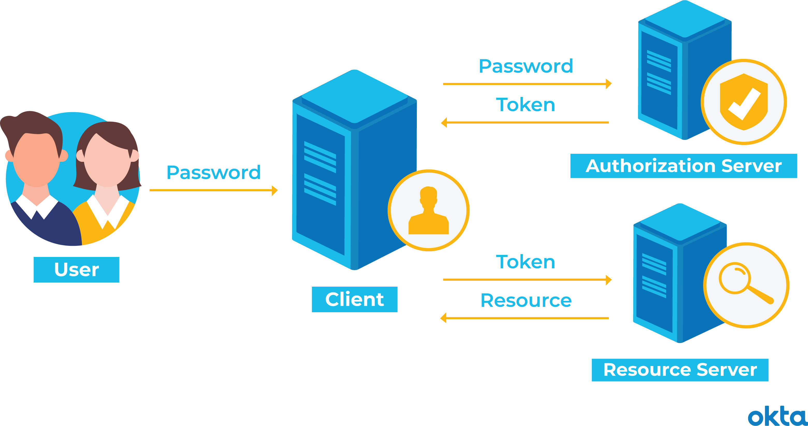

# Learn about APIs

#### Links

- [Introduction to REST API - RESTful web services](https://habr.com/ru/post/483202/)
- [Differences between REST and SOAP](https://habr.com/ru/post/483204/)
- [REST API development - what is Contract First?](https://habr.com/ru/post/483206/)
- [REST API development - what is Code First?](https://habr.com/ru/post/483322/)
- [REST API - what is HATEOAS?](https://habr.com/ru/post/483328/)
- [REST API recommendations - Java and Spring web service design examples](https://habr.com/ru/post/483374/)
- [Developing REST APIs](https://dzone.com/articles/developing-rest-apis)
- [10 API testing tips for beginners (SOAP and REST)](https://dzone.com/articles/10-api-testing-tips-for-beginners-soap-amp-rest)
- [gRPC and everything else](https://proglib.io/p/grpc-i-vse-vse-vse-chast-i-vvedenie-2021-03-26)
- [JSON API - working by the spec](https://habr.com/ru/company/oleg-bunin/blog/433322/)
- [JSON API implementations](https://jsonapi.org/implementations/#client-libraries-php)
- [What is GraphQL: from basics to first queries](https://ru.hexlet.io/blog/posts/chto-takoe-graphql-s-osnov-do-pervyh-zaprosov)
- [Testing PHP API against OpenAPI definitions - Laravel example](https://habr.com/ru/company/otus/blog/565710/)
- [Why tokens are hard to fake: JWT authorization explained](https://highload.today/blogs/jwt-avtorizatsiya/)

## REST [&uarr;](#learn-about-apis)

REST stands for REpresentational State Transfer. It is a popular architectural approach for building APIs.

### HTTP protocol

    When you enter a URL in the browser (for example, www.google.com), the browser sends a request to the server
    identified by that URL.
    The server forms and returns a response. The format of these requests and responses is defined by HTTP
    (HyperText Transfer Protocol).

    When you type a URL in the browser, it sends a GET request to the server. The server responds with HTML
    (HyperText Markup Language), and the browser renders it.

    If you submit a form on a page, the browser sends a POST request to the server.

### HTTP and RESTful web services

HTTP provides the base layer for web services. Key abstractions:

Resource

A resource is the key abstraction in HTTP. It is anything you want to expose to the outside world. For example, in a
work tracking app, resources could be:

    A specific user
    A specific task
    A list of tasks

Resource URI

When building RESTful services, you focus on resources. You identify a resource by its URI (uniform resource
identifier). Examples:

    Create a user: POST /users
    Delete a user: DELETE /users/1
    Get all users: GET /users
    Get one user: GET /users/1

REST and resources

REST forces you to think in terms of resources:

    Define which resources you want to expose.
    Use HTTP verbs to operate on those resources.

Typical REST service characteristics:

- Data exchange format: no strict limits. JSON is popular, but XML or others are possible.
- Transport: HTTP. REST is built on HTTP.
- Service definition: no formal standard. Some scenarios require request/response specs. WADL and Swagger/OpenAPI are
  commonly used.

REST focuses on resources and how efficiently you perform operations on them using HTTP.

### HTTP components

HTTP request structure:

    request line - identifies the request type
    header fields - describe metadata and transfer parameters
    optional body

HTTP response structure:

    status line with status code and reason phrase
    header fields
    optional body

HTTP methods indicate the requested action:

    GET: read a resource
    POST: create a resource
    PUT: update a resource
    DELETE: delete a resource

HTTP responses always include a status code. Common examples:

    200 - success
    404 - page not found

## REST and SOAP [&uarr;](#learn-about-apis)

REST and SOAP are not directly comparable. SOAP is a protocol format based on XML, while REST is an architectural
approach.

Comparison highlights:

    - RESTful example: JSON over HTTP
    - SOAP example: XML over SOAP over HTTP

Message format:

    - SOAP uses SOAP XML for requests and responses.
    - REST has no fixed format. JSON is the most common, but XML and others work too.

Service definition:

    - SOAP uses WSDL (Web Services Description Language), an XML-based definition language.
    - REST has no standard definition language. WADL was proposed but is not popular. Swagger/OpenAPI is common.

Transport:

    - SOAP can use HTTP or MQ and does not restrict transport.
    - REST is designed for HTTP.

Implementation complexity:

    - RESTful services are usually easier to implement.
    - REST typically uses JSON, which is easier to parse. It also does not require a formal service definition.
    - SOAP requires WSDL and has overhead due to SOAP XML parsing.

When building a service, you can use one of two approaches:

    - Code First: generate the contract from code
    - Contract First: build code based on the contract

## SOAP [&uarr;](#learn-about-apis)

RPC (Remote Procedure Call) is a class of technologies that let programs call procedures in a different address space
(another node or system). One implementation is SOAP, an XML-based protocol for network API requests. SOAP is often used
over HTTP but tries to be transport-independent and avoids relying on HTTP features. Instead, it uses related standards
(WS-*). A SOAP web service API is described with WSDL (Web Services Description Language). SOAP originally focused on
RPC.

SOAP is a protocol for web services to communicate with each other or with clients. The name stands for Simple Object
Access Protocol. A SOAP API is a web service that uses SOAP to exchange messages between servers and clients.

SOAP was introduced in 1998 and became a major web services standard, especially with Microsoft .NET. Today it is less
popular than REST, but SOAP services are still common in banking and telecom.

SOAP can use SMTP, FTP, HTTP, or HTTPS. Most often it uses HTTP because it is universal. A valid SOAP message includes
Envelope, Header, Body, and Fault elements.

## JSON APIs [&uarr;](#learn-about-apis)

In 2013, Steve Klabnik summarized JSON API practices into a formal JSON API specification and registered it as a media
type on top of JSON.

The site http://jsonapi.org/implementations/ lists implementations: 170+ for 32 languages, plus libraries, parsers, and
serializers.

### JSON API pros

The JSON API spec solves common problems by enforcing conventions. Having a shared agreement prevents endless team
bikeshedding. When someone does something wrong, you can simply say, "Not JSON API," and point to the spec.

Many teams adopt JSON API by default for new services. There are reserved keys (data, meta, include) and filter
conventions (filters). URL formats are described.

With fewer arguments, development is faster. The backend follows the spec, the client integrates, and the customer is
happy. Many common issues (like pagination) are already solved.

Because it is JSON, it is more compact than XML and easier to read.

### JSON API cons

The object shape grows (data, attributes, included, etc.), so the frontend must parse nested structures. Not all junior
engineers are comfortable with that, though serializers/deserializers help.

On the backend side:

- Nested include depth can explode.
- Database queries can become heavy when generated automatically.
- Security risks increase if libraries expose too much.
- The spec is long and in English, which can be a barrier.
- Not all libraries implement the spec well.

### JSON API pitfalls

A few examples:

1) The number of relationships is unlimited. If you include comments on an article, you may get all comments, even
   10,000 of them.

        GET /articles/1?include=comments HTTP/1.1

        01. ...
        02. "relationships": {
        03.   "comments": {
        04.     "data": [0 ... infinity]
        05.   }
        06. }

   The response could be 5 MB. The fix is to reformulate the request:

        GET /comments?filters[article]=1&page[size]=30 HTTP/1.1

        01. {
        02. "data": [0 ... 29]
        03. }

2) The same data can be requested in ambiguous ways:

   - GET /articles/1?include=comments HTTP/1.1
   - GET /articles/1/comments HTTP/1.1
   - GET /comments?filters[article]=1 HTTP/1.1

   These are equivalent but produce ambiguity.

3) Polymorphic one-to-many relations show up quickly in REST:

       01. GET /comments?include=commentable HTTP/1.1
       02.
       03. ...
       04. "relationships": {
           05.   "commentable": {
           06.     "data": { "type": "article", "id": "1" }
           07.   }
       08. }

   The backend has a polymorphic relation commentable and it surfaces in REST. In JSON API you cannot hide it.

4) Complex many-to-many relations with extra attributes also surface:

       01. GET /users?include=users_comments HTTP/1.1
       02.
       03. ...
       04. "relationships": {
           05.   "users_comments": {
           06.     "data": [{ "type": "users_comments", "id": "1" }, ...]
           07.   }
       08. }

## gRPC [&uarr;](#learn-about-apis)

gRPC is a modern framework for building scalable, fast APIs. It is an RPC system created by Google in 2015. It is used
by companies like Google, Square, and Netflix. It lets you write microservices in any language and connect them easily.
It uses HTTP/2 as transport, which reduces latency and allows multiple requests over one connection, improving
performance and page load speed.

Interfaces are described using Protocol Buffers (protobuf), which define data structures for encoding and exchange.
Protobuf is smaller and faster than XML because it uses binary data.

API types in gRPC:

- Unary: a synchronous client request that blocks until a server response arrives.
- Server streaming: the server opens a stream and sends multiple messages to the client.
- Client streaming: the client streams messages to the server.
- Bi-directional streaming: both client and server open streams; the server can send initial data or respond to each
  client request in a ping-pong style.

Load balancing in gRPC:

Client-side load balancing is common. The client uses a simple round-robin algorithm across the list received from a
load balancer. More advanced policies can be implemented on the LB side.

## Swagger [&uarr;](#learn-about-apis)

Manual documentation is tedious, so developers created Swagger. It can generate API specs from code.

Swagger is a set of tools that help describe APIs. It lets people and machines understand a REST API without direct
code access. It helps generate documentation and share it with developers or clients.

In 2015, Swagger was donated to the OpenAPI Initiative. The specification is now called OpenAPI. Swagger is the tooling
that works with OpenAPI. Calling the spec itself Swagger is not accurate.

OpenAPI specs are written in YAML or JSON and are JSON objects.

Swagger supports two approaches:

- Auto-generate from code.
- Manually write specs.

Auto-generation is easier: add dependencies, configure settings, get docs. But code readability can suffer and docs are
not perfect. Still, the minimum is done.

Manual writing requires learning the syntax. You can use YAML/JSON and tools like Swagger Editor. This approach yields
higher quality, more customized docs.

If your backend developer needs to document a simple API, it is easy. If it is a JSON API, it is harder to describe
with Swagger.

## GraphQL [&uarr;](#learn-about-apis)

GraphQL is an open-source query language.

Three key characteristics:

- It lets the client specify exactly which data it needs.
- It simplifies data aggregation from multiple sources.
- It uses a type system to describe data.

### High entry barrier

From the frontend side, it looks great, but a new developer needs time to learn it. Like SQL, you should study it
before writing it.

### Big bang effect

If a project had no API and you move to GraphQL, a month later you may realize it does not fit. At that point it is
hard to roll back. With JSON API or OData you can evolve gradually from simple RESTful endpoints.

### Backend pain

GraphQL can be a backend nightmare, similar to a fully implemented JSON API, because it gives full control over
queries. You must manage:

- nesting depth
- recursion
- rate limits
- access control

## Cookie-based [&uarr;](#learn-about-apis)

Cookie-based authentication usually works in these steps:

#### Step 1: Client - signing up

The user signs up. The client sends an HTTP request to the server with username and password.

#### Step 2: Server - handling sign up

The server hashes the password before storing it. If someone gains access to the database, they will not see plaintext
passwords.

#### Step 3: Client - user login

The user logs in. The client sends an HTTP request with username and password.

#### Step 4: Server - validating login

The server looks up the username, hashes the supplied password, and compares it to the stored hash. If it fails, the
server can deny access with a 401 status.

#### Step 5: Server - generating access token

If validation succeeds, the server creates an access token that identifies the user session.

The server does two things:

- Stores the token in the database for that user.
- Attaches it to a response cookie returned to the client. Set an expiration date/time.

Cookies are sent with every request and response between client and server.

#### Step 6: Client - making page requests

When the client requests a protected page, the server reads the access token from the cookie and checks it against the
stored token. If it matches, access is granted.

Clear cookies on logout.

## OAuth [&uarr;](#learn-about-apis)

OAuth is a popular protocol that allows services to integrate and share user data securely. OAuth can connect two
services, each with its own user base.

OAuth 2 is an authorization framework that lets applications (Facebook, GitHub, DigitalOcean, etc.) obtain limited
access to user accounts on an HTTP service. It works by delegating authentication to the service hosting the user
account and authorizing third-party apps to access it. OAuth 2 provides flows for web, desktop, and mobile apps.

## Basic Auth [&uarr;](#learn-about-apis)

You can use header() to send an "Authentication Required" response, which triggers a browser login dialog. When the
user enters credentials, the PHP script is called again with predefined variables PHP_AUTH_USER, PHP_AUTH_PW, and
AUTH_TYPE set in the $_SERVER array. Only "Basic" and "Digest" are supported.

Example of Basic HTTP authentication:

      <?php
         if (!isset($_SERVER['PHP_AUTH_USER'])) {
             header('WWW-Authenticate: Basic realm="My Realm"');
             header('HTTP/1.0 401 Unauthorized');
             echo 'Text sent when the user clicks Cancel';
             exit;
         } else {
             echo "
Hello {$_SERVER['PHP_AUTH_USER']}.
";
             echo "
You entered {$_SERVER['PHP_AUTH_PW']}.
";
         }
      ?>

## Token-based Auth [&uarr;](#learn-about-apis)

Token-based authentication allows users to verify identity and receive an access token. During the token lifetime,
users access the website or app with that token instead of re-entering credentials.

Auth tokens work like stamped tickets. Access continues as long as the token is valid. When a user logs out or quits an
app, the token is invalidated.

Tokens provide a second layer of security and allow detailed control over actions and transactions. They require some
coding know-how, but most developers pick it up quickly.

### Token authentication in 4 steps

- Request: the user asks for access to a server or protected resource.
- Verification: the server confirms access (password or other checks).
- Token issuance: the server issues a token and passes it to the user.
- Storage: the token lives in the user browser while work continues.

If the user requests a different resource, the token is checked again. Access is granted or denied accordingly.

Administrators set token limits. Tokens can be one-use or expire after a defined time period.

## JWT [&uarr;](#learn-about-apis)

JSON Web Token (JWT) is an open standard for transferring claims between parties in a web environment. It is used to
encode and transfer data for authorized users between an identity provider and a service provider.

In simple terms, a JWT is a string in the format header.payload.signature. Suppose we register on a site. We have three
participants: the user, the application server, and the authentication server. The authentication server issues a token
that the user later uses to interact with the application.

The application uses JWT to verify authentication:

1. The user authenticates with the auth server (login/password, Facebook key, Google key, etc.).
2. The auth server creates a JWT and sends it to the user.
3. The user includes the JWT in API requests.
4. The application verifies the JWT from the request to confirm identity.

JWT has three important components:

- Header: token type and signing algorithm.
- Payload: issuer, expiration, and other claims.
- Signature: verifies the message integrity.

## OpenID [&uarr;](#learn-about-apis)

OpenID is a protocol that uses OAuth 2.0 authorization and authentication mechanisms and is widely adopted by identity
providers. It solves the problem of sharing user identity across many web services.

OpenID allows you to use credentials from an OpenID provider (such as Google) to log in to another app. For example,
example.com can ask you to sign in with a Google or Facebook account. The site redirects you to the provider, you
authenticate, and then you are allowed access.

### OpenID vs OAuth

OpenID is for authentication, OAuth is for authorization.

OpenID provides federated authentication: a third-party app can authenticate users using accounts they already have.
OAuth was created to avoid sharing passwords with third-party apps.

Both protocols can be used for similar tasks, but should not be used interchangeably. OpenID provides an identity
assertion, while OAuth is more generic. With OAuth, a server issues an access token to a third party, the token is used
to access a protected resource, and the source validates the token. The token does not verify the identity of its owner.

Think of a token like a movie ticket. It grants access but contains no identifying information. A bad actor could use a
stolen token.

## SAML [&uarr;](#learn-about-apis)

SAML (Security Assertion Markup Language) is a secure XML-based communication mechanism for exchanging authentication
and authorization data between organizations and applications. It is often used for web SSO (single sign-on). It
eliminates the need to store multiple credentials for different organizations. In short, you can use one account (for
example, username and password) to access multiple applications.

A SimpleSAMLphp instance connects to an authentication source, such as LDAP or a user database. It authenticates users
against that source before granting access to resources provided by the service provider.

## HATEOAS [&uarr;](#learn-about-apis)

HATEOAS stands for "Hypermedia As The Engine Of Application State".

When you request account data, you get both:

- account number and balance data
- links that allow deposit, withdraw, transfer, or close actions

With HATEOAS, a REST request returns data and actions related to that data.

Why HATEOAS matters:

The most important reason is loose coupling. If a REST consumer must hardcode all resource URLs, it is tightly coupled
with your implementation. If you return URLs for actions in the response, the client is loosely coupled. There is no
strict dependency on URI structure, because it is provided in responses.

## OpenAPI Specs [&uarr;](#learn-about-apis)

OpenAPI is a specification that describes RESTful API interfaces in JSON and YAML so that both humans and machines can
understand them.

OpenAPI definitions are language-agnostic and can be used in many ways.
