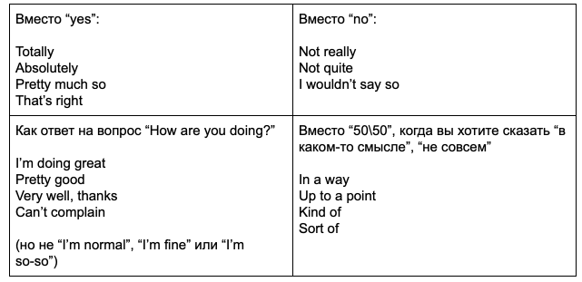
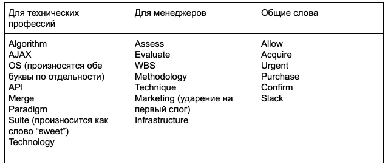

## Just a few tips:

### "I don't know"?

- Sorry, I don't have enough experience with Kubernetes.

Try to avoid negative constructions. The phrase "I wish I had ..." is honest but gently shows that you lack something
right now.

- I wish I had more experience and expertise related to Kubernetes.

Even better, add that you know a related technology (language, framework) that can help you learn the required skill.

- I wish I had more experience and expertise related to Kubernetes. However, I have experience working with cloud native
  tools and I'm pretty good at using Go.
- Kubernetes is written in it, so I believe I can make it out quite efficiently. My knowledge and hands-on experience
  with SpringBoot will be helpful as well.

If you cannot use the related-tech trick, compensate by emphasizing fast learning.

- I wish I had more experience and expertise related to Docker, and I'm ready to invest time and effort in grasping it as
  quickly as possible.
- In my previous project, I had to apply frameworks that were absolutely new to me, and I was able to learn on the fly.
- I've never done it, but I'm a quick learner.
- I see this job as an opportunity to learn more about this topic.

---

- Use words like please, could you, and thank you.

---

- Words and phrases like you know and well fill pauses and give you a few seconds to think or build a sentence.

---

After the interview, you should ask two key questions:

- **How do you see the perfect candidate for this role?**
- **Imagine I am hired. What would you recommend me to do to succeed in my first one to three months?**

---

To sound fluent, use alternatives to "very":

- Very good = amazing, awesome, fantastic, top-notch
- Very bad = awful, terrible, lame (informal)
- Very interesting = fascinating
- Very boring = dull
- Like very much = love
- Very big = huge
- Very small = tiny
- Very important = crucial, critical, key

Filler words also help by buying time to think:

- I would say that...
- Let me see...
- You know...
- I mean...
- It's hard to remember off the top of my head...

---

When someone asks you how you are, be honest!

I'm great! I'm at an interview for a company I admire, or I'm a little nervous. I'm at an interview for my dream job.

How are you?

- How are you doing?
- How are you doing today?
- How has your day been so far?
- How is it going?
- How do you do?
- What's up? (informal, American)
- How have you been?
- How've you been?
- How's life?

- Hi! How are you doing today?
- How's your day going so far?
- Hello! Thanks for taking the time to chat with me.
- Hi! Thanks for arranging this interview. How's your week going?
- Hi! I hope I'm not catching you at a busy moment. How's it going?
- Hello! I'm looking forward to our chat. How's your schedule today?

Answers

- Fine
- Fantastic
- Pretty good
- I'm doing great, thanks for asking.
- Couldn't be better! And yourself?
- A bit busy but fine all in all. How are you?
- I'm fine, thank you.
- Not bad at all. What about you?
- Not too bad. You? (British)
- So far so good.
- I'm doing well.
- Great, thank you. How are you?
- Good, thanks, and you?
- Great, great, thanks.
- Fine, thanks. It's a beautiful day.
- I'm good (also works if someone offers you a drink and you decline).

To start

- Well, let's get started if you don't mind. Actually, I wanted to ...
- It's about to start.

Compliments:

- I'm really impressed by the place: very spacious, lots of air. I've noticed a lot of meeting rooms along the way.
  Cool!

If you are stressed:

- I'm a bit stressed but excited at the opportunity to talk to you. Overall, I feel I'm ready to walk you through the
  main highlights of my resume and answer your questions.

Other:

- Cool!
- Oh, really?
- That's amazing!
- I know exactly what you mean...
- What happened next?
- Oh, wow!
- Oh, I see.
- That sounds great.
- That's interesting.

- Beautiful day, isn't it?
- Great weather if you're a duck, right?

- Did you do anything exciting over the weekend?
- Any plans for the weekend?

- Oh, nothing in particular, just chilling.
- Meeting some friends, maybe a picnic in a park.
- Oh, just the usual - I'll do some sports.
- I'm looking forward to getting some sun this summer!
- It was a nice weekend trip! Didn't know that < fun fact >.

---

### Wrapping Up

- **It's been great chatting with you! Thanks for taking the time.**
- **Thanks for the great conversation. I'm excited about what's next!**
- **I appreciate you sharing more about the role and the company.**
- **I really enjoyed learning more about your team. Thanks for sharing!**
- **It was great to meet you. I'm looking forward to the next steps.**
- **Thanks for your insights, they've been really helpful.**
- **I appreciate the opportunity to connect today.**
- **I'm looking forward to hearing back from you soon!**
- **Thanks again for your time and have a great rest of your day!**
- **It's been a pleasure talking to you - hope we get the chance to work together!**

---

### General Interest and Fun

- **What do you like to do in your free time?**
- **Have you picked up any new hobbies recently?**
- **What's something fun you've done recently?**
- **Are you into any sports or activities?**
- **What's the last concert or event you went to?**
- **Do you enjoy outdoor activities like hiking or biking?**
- **Do you follow any sports teams?**
- **Are you more of an early bird or a night owl?**
- **What's your favorite way to spend a day off?**
- **Do you prefer to relax at home or go out for fun?**

---

### Tech and Industry

- **How do you see the tech industry evolving in the next few years?**
- **What's the most exciting trend in tech right now, in your opinion?**
- **Do you have a favorite programming language?**
- **How has technology changed your role as a recruiter?**
- **Are there any tools or platforms you're currently excited about?**
- **What's the biggest challenge you face as a recruiter in tech?**
- **Do you think AI will significantly change recruiting in the future?**
- **What's your favorite part about working in tech recruiting?**
- **Are there any tech trends you're particularly following right now?**
- **How do you stay updated with the latest tech advancements?**

---

Do not speak in a long monologue. Make sure they understand you:

- Does that make sense?
- If you get me?
- I'm not sure - am I making myself clear?
- Do you know what I mean?
- Yeah?

Use correct request forms:

- Can you repeat please?
- Could you repeat it, please?
- Would you mind doing this for me?

A polite way to phrase requests:

- Why don't you...
- Why don't you give me your updates?

A few polite ways to ask for clarification if you don't understand what someone said:

- Excuse me, I didn't quite understand. Could you repeat that?
- I didn't catch that. Could you repeat it, please?
- Could you explain that a bit more, please?
- What do you mean by that?
- Could you clarify what you meant?
- Can you explain that in another way, please?
- Could you say that in a simpler way?

---

For many of us, it is normal to speak and write directly and briefly. For native speakers it is the opposite, and they do
not consider directness polite - it is just how they speak.

Politeness matters most when you need to ask for something. We think that saying "Send me this document" might be a bit
rude, but if you add "please" it will sound polite and businesslike. Not really. To native speakers it can sound like
you are annoyed or even angry. It sounds like a demand, not a request.

How to phrase requests? At least start with "Can you ...?", but better "Could you ...?"

### Simple and polite requests:

1. **Could you send me the document, please?**
2. **Can you help me with this task when you have a moment?**
3. **Would you mind sharing the details of the meeting?**

### An even softer approach:

1. **I was wondering if you could send me the document when it's convenient for you.**
2. **Would it be possible for you to take a look at this report?**
3. **If you have a moment, could you assist me with this issue?**

### Showing respect for the other person's time:

1. **Whenever you have time, could you send me the updated file?**
2. **If it's not too much trouble, could you check this for me?**

### Leading into a request with context:

1. **I need to finalize the report, and I noticed there's some data missing. Could you provide that information?**
2. **We're preparing for the presentation, and it would be great if you could review the slides.**

### Sound extra friendly:

1. **Do you think you could help me with this?**
2. **Would you be able to send me that document? I'd really appreciate it.**

### Tips:

- **Could** sounds more polite than **can**, especially in formal contexts.
- Phrases like **I was wondering if...**, **Would it be possible...**, and **If it's not too much trouble...** make a
  request softer.
- End a phrase with **please**, **thank you**, or **I'd appreciate it** to signal gratitude and respect.

Example:

Instead of **Send me the report**, say:
**Could you send me the report when you get a chance? Thanks so much!**

---

## If you want to criticize, refuse, and give feedback in English, use these phrases:

**I'm afraid** - a safe phrase to decline any request:
I'm afraid, I can't help you.
I'm afraid, it's not going to be possible.

**I have noticed that** - for cases where you are dissatisfied or something concerns you:
I have noticed that you haven't replied to my calendar invite. Will we see you in tomorrow's meeting?

**I'm not sure about that** - actually means "I disagree" or "I don't like it". If you are truly unsure, say:
I don't know about that.

**Not really** - a very simple phrase used by natives because a blunt "no" often sounds too harsh:
Would you like to work on this project? - Not really, I was hoping for something a bit more challenging.

**I am going to need you to...** - for assigning a task rather than just asking. Keep "going to" to sound polite.
Example:
We're expecting a surge in user traffic in the next month so I'm going to need you to make sure that we can handle it.

**Will do** - reply when someone assigns you a task. It sounds friendlier than just ok.
Could you forward that email to me? - Ok, will do.

For refusing:

1. **I'm afraid I can't help you with that right now.**
2. **I'm afraid it's not going to be possible to meet the deadline.**

For politely pointing out a problem:

1. **I have noticed that the document is missing some key details. Could you double-check it?**
2. **I have noticed that you haven't joined the weekly meetings recently. Is everything okay?**

For expressing doubt:

1. **I'm not sure about that approach. Maybe we should explore other options.**
2. **I don't know about this design - it feels a bit outdated.**

For a soft refusal:

1. **Would you like to lead the next meeting?**
   - **Not really, I think someone with more experience should take it.**
2. **Can you stay late to finish this task?**
   - **Not really, but I can prioritize it tomorrow morning.**

For assigning a task:

1. **I'm going to need you to review the presentation slides before the meeting.**
2. **I'm going to need you to make sure all the data is backed up before the system update.**

For confirming a task:

1. **Can you update the client on the project status?**
   - **Will do.**
2. **Please send me the latest report by the end of the day.**
   - **Got it, will do.**

---

In business conversations, small talk should not take too long, but it should exist at least in the first minute. A
simple "How are you doing?" or "How is your day going / Are you having a nice day?" is enough. When you want to move on
to business, do it gently. Instead of "Let's start", say **I guess we can get started** or **Let's / I guess we can
jump into it.**

Questions to start a conversation:

1. **What brings you here?**
2. **Is this your first time at this event/place?**
3. **Are you enjoying the food/music/weather?**
4. **What does your company do?**
5. **What do you do at [company name]?**
6. **Have you been to this kind of event before?**

Small talk questions:

1. **How is your day going?**
2. **How are you finding the event so far?**
3. **Did you have to travel far to get here?**
4. **Have you tried the [specific food or drink]? It's really good!**

A smooth transition to business:

1. **I guess we can get started whenever you're ready.**
2. **Shall we jump into it?**
3. **Maybe we can start by discussing [specific topic].**
4. **How about we get into the details now?**

---

### Notes

You can "level up" quickly and without much effort using a few common phrases native speakers often use (but we often
ignore). For example:

---

Pay special attention to pronunciation. Check how you pronounce your most frequently used words (for example, in Google
Dictionary). You can start with this list:

---

Use the `bullet point approach` - highlight key points and rehearse your answer. Your goal is to sound easy and natural.

---

Do not avoid `small talk`. Show that you can keep a relaxed conversation on different topics. Be ready to talk about
what you do outside of work, your favorite books, hobbies, and so on. Be friendly and answer "How are you?" with
"I'm great/very well/doing good. What about yourself?", not "Normal" (which is incorrect) or "Not bad".

---

Thank the interviewer by sending a `follow-up` email after the interview. This helps you stand out and shows that you
are familiar with English-speaking communication culture.

---

The main indicator of your level in an interview is, first, that you speak without being pulled into it. Second, a
coherent speech without stumbles, stuttering, or long pauses. Watch your pace. It is better to speak more slowly and
steadily than fast and messy.

---

`Try to give detailed answers`. If you answer everything with one word, your level cannot be assessed. No one will know
whether you are upper or intermediate if each answer is one word.

---

Practice `active listening` - listen and react to comments. This shows interest and that you know how natives
communicate. Nobody will label you Pre-Intermediate even if you said will after if :)

---

For grammar, focus on the basics and do not cram new rules the day before the interview. The essentials you need most:

- `Past Simple` - for past projects, previous jobs, first steps, etc. Always used when your sentence answers "When
  exactly in the past?" Example: I designed my first app when I was in university.
- `Present Perfect` - for results up to now. Example: "I've worked at my current company for 6 years".
- `Going to` - for future plans. Example: "I'm going to take a PMI exam this spring".
- `Present Simple` - for actions that happen regularly. Example: "I very rarely travel abroad".
- Also topics like `Gerunds` and `Infinitives`, `First` and `Second Conditionals`, and `Prepositions`.

---

`Secret grammar tip`: you will almost always be asked, "How long have you been working as ...?" Many people fail because
they answer in the wrong tense: "I work/I'm working as a developer for 5 years". This is wrong. In English, it is
simple: answer in the same tense as the question (often). Plus you have the time marker "for", so if you do not use the
Present Perfect Continuous like in the question, your level will sound like weak Intermediate.

---

`Practice makes perfect!` Always rehearse before an interview. Yes, like in movies, Americans stand in front of the
bathroom mirror and repeat their speech. But do not memorize. You should sound relaxed and natural.

---

### DIFF

Work relationships are market relationships. One person sells their services and time, the other buys them. If the price
isn't right, the seller looks for another buyer, and the buyer looks for another seller. If finding a suitable price
doesn't work, negotiations begin. There's no place for personal grudges here.

---

The only way forward is to let go and not worry about the level of your language skills. Remember that the official
language of Europe is "bad English," and just push straight ahead toward your goal. That's it.

---

Many companies operate in English, aiming for an international team or market. If you can pass a technical interview in
English, then you won't face any issues during the work. The same goes for German.

---

What about the salary?

1. **During the screening**:
   - If the range is mentioned, give a salary within that range.
   - If the range is higher than your expected salary, DO NOT UNDERCUT. State a salary from the range instead.
   - If no range is provided, say that you're not very familiar with current market trends as you recently started
     interviewing. Ask what range they have in mind.
   - If you know your minimum range, state it to ensure you're not losing out on salary.

2. **After technical interviews**:
   - Here, you can negotiate.
   - You can leverage other offers, but do it carefully.
   - At this point, they are likely comparing you with other candidates.
   - If you've passed the technical stage, don't hesitate to state your desired salary.

---

### What do you expect from colleagues?

- No specifics - just that I want people to be good and reasonable.
- I just want to do the work, no special expectations.

---

### Tell me about yourself

- No more than a minute.
- Don't mention any problems - you're the ideal employee who NEVER COMPLAINS.
- Don't bring up things that might reduce your reliability - like health issues, documentation problems, etc.
- Don't mention crazy career expectations - they might think you'll leave the company soon.
- Simply say that you're an AVERAGE WORKER - you have a gaming console, a bike, a wife, a child, and are considering a
  mortgage. Someone WITHOUT BIG COMMITMENTS is more likely to leave the job, while a family person is more likely to put
  up with things.
- DON'T INTERPRET ANYTHING - keep it simple, as certain details can be interpreted either positively or negatively.

---

### How do you choose between two urgent tasks?

1. I will inform the team lead and the project manager.
2. If I decide on my own, I choose the one I can complete faster and then do the second task.

---

### What is most important at work?

- Give the impression that you're a GOOD WORKER - someone without issues, who does what they're told, is neutral about
  work, gets along with colleagues, and isn't stressed by challenges.
- Don't give any SPECIFIC DETAILS - just vaguely explain that you simply want to do the work. When there are complex
  tasks, you switch to easier ones; if conflicts arise, you deal with them, and when bored, you ask if there's anything
  else to do. Sometimes, you take on new projects to develop your skills, and if you're too tired, you take a day off.
- IDEAL ANSWER - say there's nothing specific that bothers you. This suggests you don't have reasons to complain. Just
  explain how you deal with things, and it will become clear that YOU'RE A RELIABLE GUY.

---

### Why should we hire you?

- I don't know - because I'll have to praise myself.
- Based on the job posting, I seem to fit the role.
- There are certain details to clarify, but we'll figure those out in the process.
- I can handle the work and will integrate well into the team.
- I'm interested in this job, and I think I can handle it.

---

### What do you like about work?

- Don't go into too much detail.
- I've been lucky with work - I haven't faced major difficulties.
- I like my colleagues.
- The pay is good.
- There's room for growth.
- I can't pick just one thing - there are many interesting aspects.

---

### How do you see your development within our company?

- What if it's a horrible legacy codebase?
- You have a lot of projects - I'll be able to grow and improve my skills.
- I'm interested in the processes.
- I'm intrigued by the business domain.
- I'd like to become a tech lead eventually.

---

### What would you do if the manager asked for a hotfix?

- If it's a regular occurrence, I'd create a task for it.
- If it's a minor, irregular issue, I'd just do it.
- Document it properly.
- Determine the correct priority for such fixes.

---

### When can you start working?

- If the goal is just interview practice, you can receive an offer and not accept it, or say that you got a better
  offer and already accepted it.
- I will clarify the details and let you know the approximate start date.

---

### What to do if there's chaos in the processes?

- Show that you won't run away in such a situation.
- Figure out what's going on.
- Find out if it's a regular issue.
- Ask the manager how to handle it.
- Offer to help the manager or colleagues.

---

### What are your first steps in a new job?

- I'll listen to you on the first day.
- I'll review the available documentation.
- I'll check access permissions and repositories.
- Get familiar with the first task.
- Set up the projects.
- After the first weeks, I'll ask the team lead for feedback.

---

### Do you have any hobbies?

- Avoid mentioning anything unusual.
- Avoid hobbies that take up too much time.
- Avoid things that interfere with work.
- Just DON'T STAND OUT - you're an ordinary person without strange hobbies.

---

### Why are you looking for a job? (Not why you left your previous one)

- If you worked there for a long time, simply mention foundational issues - legacy code, etc.
- It's important to show that you're not crazy but a normal person.

---

### Why did you leave your previous job?

- NEVER badmouth previous colleagues or the company - if you worked at a bad company, it reflects on you.
- MAIN REASON - organizational issues - moved, worked on documents, solved long-term problems, and persevered.
- DON'T SAY you're tired of the tech stack or want to work with new tools - it's a red flag suggesting you'll leave in
  six months for something new.
- DON'T MENTION past conflicts or failures at your old job.

---

### What is the most important thing at work?

- Answer vaguely without specifics.
- I'm just looking for a job.
- I'm looking for a team - either to learn from someone or to teach someone.
- I don't have any particular demands.

---

### Three of your positive qualities

- Consistency.
- I enjoy my work - no significant burnout.
- I like interacting with colleagues - interesting people.

---

### How do you handle conflict situations?

- DON'T USE real stories.
- Make something up that is SIMPLE and REFINED - there was a task where the team lead set a development strategy, code
  styles, and feature deployment rules, but the manager wanted the task closed quickly. The problem was that they
  couldn't agree because both were right. So, I reached out to colleagues - we found a similar task that had been solved
  before, and we finished the task on time while following all the development rules. In the end, I suggested we create
  a plan for future situations like this. Meaning, you weren't part of the conflict but helped solve it. You're so cool
  that you never argue with anyone and are tactful in all situations.

---
