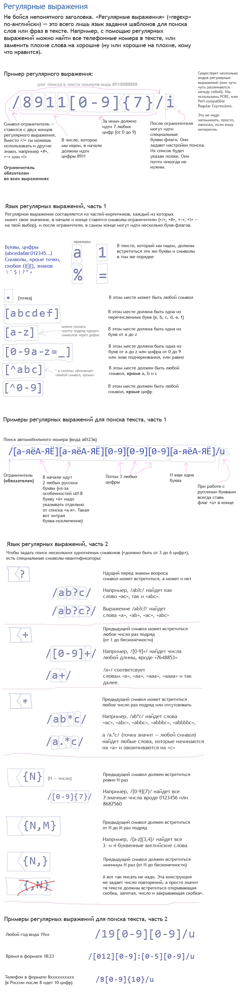
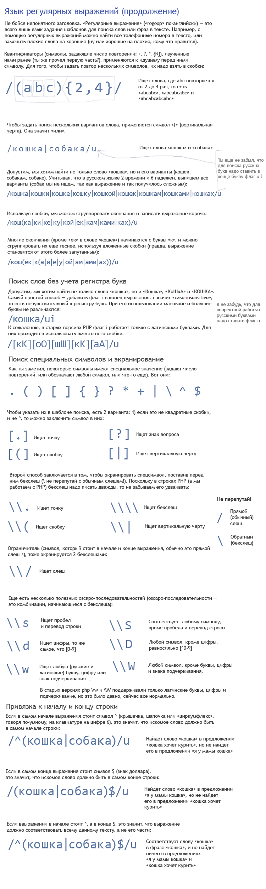
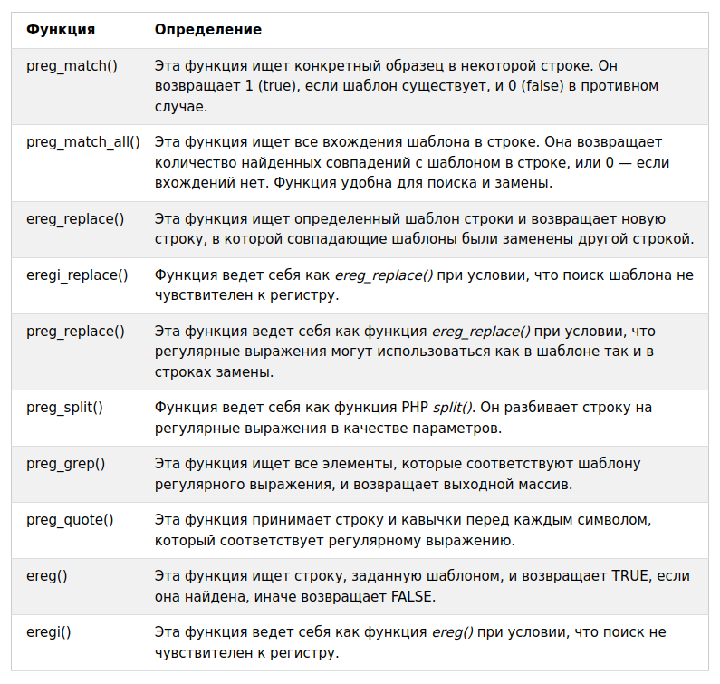

# Regular Expressions

#### Links

- [Regular expressions](https://en.wikipedia.org/wiki/Regular_expression)
- [http://archive-ipq-co.narod.ru/l1/regexp.html](http://archive-ipq-co.narod.ru/l1/regexp.html)
- [Regular expression tester with syntax highlighting, explanation, cheat sheet](https://regex101.com/)
- [Greedy and lazy quantifiers](https://learn.javascript.ru/regexp-greedy-and-lazy)

## Examples [&uarr;](#regular-expressions)

## Regular Expression Functions in PHP [&uarr;](#regular-expressions)

