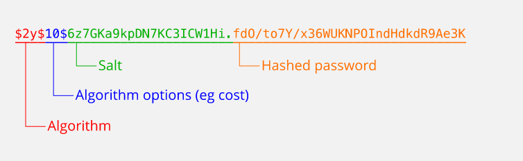

# Web Security

#### Links

- [SSL certificates](https://doka.guide/tools/ssl-certificates/)
- [Secure password hashing](https://www.php.net/manual/ru/faq.passwords.php)
- [CORS: background, how it works, best practices](https://habr.com/ru/company/macloud/blog/553826/)

## Vulnerabilities [&uarr;](#web-security)

### Types of PHP vulnerabilities

#### SQL injection

SQL injection is one of the most accessible ways to hack a site. The idea is to inject arbitrary SQL code into data
passed via GET, POST, or cookies. If the site is vulnerable and executes such injections, you can effectively do
anything with the database (most often MySQL).

Possible SQL injection techniques:

1. The simplest: reducing a WHERE clause to a condition that is always true.
2. Appending results of another query using the UNION operator.
3. Commenting out part of the query.

#### Cross-site scripting (XSS)

XSS (Cross-Site Scripting) is a common web attack that injects malicious code into a page. When a user opens the
infected page, the injected script interacts with the attacker's remote server.


XSS vulnerabilities are holes in the security of a site or web app through which an attacker can inject malicious code.
Originally, the main language for such scripts was JavaScript. In theory, an XSS attack can also use HTML, Flash, and so
on. The key point is that the browser executes it.

The main classification of XSS vulnerabilities:

- Stored (persistent). The attacker gains access to the server and stores malicious code. The script runs every time a
  user visits the infected page. Stored XSS is common on forums, social networks, image boards, blogs, and other Web 2.0
  sites. Attackers may use comments, images, gifs, and other user content.
- Reflected (non-persistent). The most common type today. The attacker hides malicious code in a prepared link and sends
  it to victims via email or posts it on a page. When the user opens the link, server scripts execute the code without
  sanitization and return it in the response. The browser executes the script, and the attacker gets the victim's
  cookies.
- DOM-based. The attacker uses the Document Object Model to modify what the page shows. DOM-based XSS can be reflected
  or stored. The page itself does not change, but the browser rendering does due to malicious DOM changes.

XSS vulnerabilities also differ by activity:

- Active. The script runs automatically when the victim lands on the page. Examples: embedded in a database or on the
  server, in input forms via automatic event handlers, and so on.
- Passive. The victim must take an action (submit a query, click a link). The attacker relies on social engineering
  such as phishing.

#### How attackers inject malicious code

The main method is through interactive elements of the site, such as search fields, feedback forms, login forms, and
comment fields. These are the simplest entry points for an attacker.

Common attack vectors include:

- Browser bugs. Vulnerabilities in browsers. A classic example is running SVG scripts to bypass same-origin policy.
  Serious bugs are usually fixed quickly, but specialized vulnerabilities may remain for years. In such cases it is
  easier to harden the site than wait for browser updates.
- Lack of escaping. Browsers cannot always distinguish between plain text and code. To execute HTML, the browser needs
  tags, so scripts go inside <script> tags and CSS inside <style> tags. If the browser interprets user input as code, it
  will execute it. This often targets comment fields. Proper escaping (automatic replacement of special characters)
  prevents user text from being executed as code.
- Encoding spoofing in page headers. Browsers detect encoding while parsing the page. If the <title> tag appears before
  the <meta> charset tag, the browser may parse the title first and only then detect encoding. An attacker can bypass
  filtering of special characters like < and " by placing encoded malicious code in the title using UTF-7.
- SiXSS (XSS with SQL injection). This is a combined attack that uses the database. The attacker injects malicious code
  into a DB row via SQL injection. If the site does not escape database output, the poisoned row is sent to users and
  executed in the browser.

In practice there are many more vectors. Some work against all types of resources, others are specialized. As a result,
there is no guaranteed 100% protection against XSS.

#### Consequences of XSS attacks

XSS vulnerabilities themselves do not harm the resource or its users. The danger is in the attacks that use these holes
as entry points. XSS can cause a wide range of damage.

**Theft of user data.** Sites and apps that require login use a cookie (session cookie) to distinguish authenticated
users. This cookie is visible to any JavaScript running in the browser, including injected scripts. After reading the
cookie, the malicious script can send auth data to the attacker's server via AJAX. This allows the attacker to:

- steal confidential data such as browsing history, payment card details, private messages
- use the victim's account to send spam, threats, or illegal content, or to post comments
- distribute malware to other users, especially those who trust the victim
- access paid content for free (courses, media, and so on)

**Control of the site.** An attacker may obtain admin privileges in addition to user data. Then they can access the
admin panel and control content, structure, and layout. This allows them to:

- get credentials of any registered user
- break functionality or design to discredit the site
- publish illegal or compromising content or edit existing content (press releases, product descriptions, and so on)
- break into a corporate database to obtain confidential information

The danger is not limited to data loss or reputation damage. Consequences can be more severe. For example, if an
attacker gains access to a pharma company's drug description, they can change dosage information, leading to serious
harm.

#### Protection against XSS attacks

- Filter and escape input parameters, i.e., user input from interactive fields and forms.
- Automatically replace special characters to separate user text from executable code.
- Place charset declarations before any user fields on each page.
- Restrict cookie domain and path using SSL or the HttpOnly flag.
- Regularly check the site or web app for vulnerabilities using tools like Nessus or Nikto Web Scanner.
- Define allowed content sources with the Content-Security-Policy header.
- Keep browsers updated and use extensions that check URLs, scripts, and interactive forms.

#### Error disclosure to users

Idea: on errors, the user sees detailed information about the error. This is not a critical vulnerability, but it gives
an attacker additional information about the server structure and behavior.

#### Exposure of system characteristics to users

Idea: the user can access data that reveals system characteristics. This is not a critical vulnerability, but it gives
an attacker additional information about server structure and behavior. The root cause is programmer mistakes or
oversights. An example is exposing a phpinfo.php file with the phpinfo() output.

#### Exposure of program source code to users

Idea: the user can access source code of modules with extensions other than .php. This is critical because it can reveal
structure and vulnerabilities.

#### Weak passwords for admin pages

Idea: an attacker can guess a simple password for an admin page and gain more capabilities. This is critical because it
allows direct influence on the server.

#### Ability to set global variables

Idea: with misconfigured PHP, attackers can set global variables via the query string. This is critical because they can
influence script execution.

#### PHP injection

Idea: a parameter that controls PHP file or code execution is passed a link to third-party code or the code itself. This
is critical because it allows executing attacker scripts on the server. Execution can happen via functions like eval(),
preg_replace(), require_once(), include_once(), include(), require(), create_function(), readfile(), dir(), fopen().

#### PHP injection via file uploads

Idea: if global variables can be set, an attacker can pass a link to third-party code or a confidential file as the
"uploaded file" parameter. This is critical because it allows running attacker scripts or accessing confidential data.
This vulnerability is only possible when global variables are allowed and file upload handling is misconfigured.

#### Email injection

Idea: a parameter controlling email sending is passed a link to third-party code or the code itself. This is critical
because it allows running attacker scripts or accessing user data.

#### SQL injection

Idea: a parameter that controls an SQL query is passed data that modifies the query to access protected data. This is
critical because it allows accessing confidential data stored in the database. To alter the query, attackers may use
constructs like SELECT, UNION, UPDATE, INSERT, OR, AND.

#### Cross-site scripting (XSS)

Idea: a parameter that controls output is passed external code. This is critical because it allows access to
confidential data stored in the client browser. Attackers typically use HTML tags to alter output.

### Rules for writing secure PHP code

#### Disable error output

It is enough to set `error_reporting(0)` in code or add this line to `.htaccess`:

```
php_flag error_reporting 0
```

#### Use strong passwords for admin pages

Use long passwords without semantic meaning (for example, `K7O0iV98dq`).

#### Log critical user actions

This does not protect directly, but helps identify attackers and the vulnerabilities they used. Log actions and related
input data for critical system operations to a plain text file.

#### Restrict access to site modules

This prevents viewing or executing module contents. Configure access in `.htaccess` using FilesMatch and Files rules.

#### Disable global variables

Set `register_globals = off` in server settings or add this line to `.htaccess`:

```
php_flag register_globals off
```

Using `ini_set('register_globals', 0)` will not help because variables are set before script execution.

#### Disable use of remote files

Set `allow_url_fopen = off` in server settings. This gives partial protection against PHP injection, but not full
protection, because an attacker can pass code directly rather than a URL. For full protection, also filter incoming
input. Sometimes this is not possible due to project requirements (for example, access to remote files).

#### Filter incoming data

This protects against most vulnerabilities. There is no universal solution. Use whitelisting combined with checks for
forbidden words. The whitelist should not include dangerous characters such as `<` or `>`. Forbidden words can include
`script`, `http`, `SELECT`, `UNION`, `UPDATE`, `exe`, `exec`, `INSERT`, `tmp`, and HTML tags.

Example:

```php
// Whitelist check. Allow only letters, digits, underscore, spaces, and dashes.
if (preg_match("/[^\\w\\s-]/", $text)) {
    $text = '';
}
// Filter dangerous words.
if (preg_match("/script|http|<|>|SELECT|UNION|UPDATE|exe|exec|INSERT|tmp/i", $text)) {
    $text = '';
}
```

#### Verify file uploads via HTTP POST

This protects against PHP injection via file uploads. Use `is_uploaded_file()` or `move_uploaded_file()`. This
protection is unnecessary if global variables are disabled.

#### Escape quotes in data sent to the database

This protects against SQL injection. The most optimal method is to process all non-numeric input with
`mysql_real_escape_string()`. You can also enable automatic escaping by adding this line to `.htaccess`:

```
php_value magic_quotes_gpc on
```

This method is not reliable and may cause double escaping.

Example with `mysql_real_escape_string()`:

```php
if (!is_numeric($text)) {
    $textrequest = mysql_real_escape_string($text);
}
```

#### Convert special characters to HTML entities before output

This protects against XSS. For user input that may contain unwanted HTML tags, use `htmlspecialchars()` on output. This
can be omitted if your input filtering removes dangerous HTML tags.

## HTTPS [&uarr;](#web-security)

HTTPS (HyperText Transfer Protocol Secure) is an extension of HTTP used to encrypt and securely exchange data between a
user and a site. All information is encrypted with cryptographic protocols TLS or its predecessor SSL. Wikipedia is
helpful. Without going deep into technical details, HTTPS encrypts data and prevents it from being intercepted.

The secure HTTPS protocol works by exchanging encryption keys. Before responding to a browser request, the server
presents a key - an SSL certificate. The browser verifies the key at a Certificate Authority. If the key is valid, the
browser and server trust each other and agree on a session cipher. This happens for each session, i.e., for each
exchange of requests and responses. That is how data confidentiality is ensured.

How it works: when you open a site, your browser receives a certificate that contains information about the site, its
owner, who issued the certificate, and more. The most important part is that the browser receives a public key, which it
uses to encrypt all data. The server holds the private key, which can decrypt the data.

If someone tries to intercept or obtain confidential data, they will only see a set of unreadable symbols. It would
take years to decrypt, and the certificate would expire long before that.

### Why a site needs an SSL certificate

To make a site work over HTTPS, you need an SSL certificate. It is a virtual document that contains data about the
organization, its owner, and confirms their existence. It lets users identify the server and verify site safety.

Using a security certificate guarantees:

- Authenticity of the resource the user accesses. This increases trust.
- Integrity of transmitted information. Data will not be modified or lost in transit.
- Confidentiality. 256-bit encryption prevents attackers from accessing the data.

Beyond protecting data, SSL certificates help with SEO. Search engines (Google, Yandex, etc.) value trust and rank HTTPS
sites higher.

## OWASP Security Risks [&uarr;](#web-security)

OWASP (Open Web Application Security Project) is an online community that publishes articles, documentation, tools, and
technologies on web application security.

OWASP Top-10 is a list of the ten most common web application vulnerabilities. It helps users understand critical
risks, their consequences, and mitigation. The list is updated every three to four years (last released in 2018). Here is
the 2020 list mentioned in the source text:

- Injection
- Broken authentication
- Sensitive data exposure
- XML External Entities (XXE)
- Broken access control
- Security misconfiguration
- Cross-Site Scripting (XSS)
- Insecure deserialization
- Using components with known vulnerabilities
- Insufficient logging and monitoring

## CORS [&uarr;](#web-security)

Browser console errors:

```
No 'Access-Control-Allow-Origin' header is present on the requested resource.
Cross-Origin Request Blocked: The Same Origin Policy disallows reading the remote resource at https://example.com/
Access to fetch at 'https://example.com' from origin 'http://localhost:3000' has been blocked by CORS policy.
```

These are examples of CORS errors. CORS is a very useful mechanism in a world of misconfigured web servers, attackers
on the internet, and organizations pushing web standards.

If a browser requests a resource from a different scheme, fully qualified host name, or port, this is a cross-origin
request.

Source and cross-origin

An origin is defined by this triple: scheme, fully qualified host name, and port. For example, http://example.com and
https://example.com have different origins: the first uses http, the second uses https. Also, the default port for http
is 80, while for https it is 443. So in this example, the origins differ by scheme and port while the host is the same.

If at least one of the three elements differs, the origin is considered different.

CORS is a mechanism that controls access to tags on a web page. It categorizes access into three types:

- Writing from different origins
- Embedding from different origins
- Reading from different origins

Embedding from different origins includes tags loaded via `<script>`, `<link>`, ``, `<video>`, `<audio>`, `<object>`,
`<embed>`, `<iframe>`, and so on. All of them are allowed by default. `<iframe>` is special because it loads another page
inside a frame. Its framing can be controlled via the `X-Frame-Options` header depending on the origin.

As for `` and other embedded tags, they initiate cross-origin requests automatically. This is why CORS distinguishes
between embedding from different origins and reading from different origins.

Reading from different origins refers to tags loaded via AJAX/fetch calls. These are blocked by default by the browser.
There are workarounds for embedding such tags, but they are regulated by other policies in modern browsers.

## SSL/TLS [&uarr;](#web-security)

An SSL/TLS certificate is a digital object that allows systems to verify identity and then establish an encrypted
network connection using the Secure Sockets Layer / Transport Layer Security (SSL/TLS) protocol. Certificates are used
within a cryptographic system known as Public Key Infrastructure (PKI). PKI allows one side to authenticate the other
using certificates (assuming both trust a third party known as a Certificate Authority). SSL/TLS certificates act like
digital identity cards for protecting network connections and establishing authenticity of websites on the internet and
resources on private networks.

### Why SSL/TLS certificates are important

SSL/TLS certificates build trust among website users. Companies install SSL/TLS certificates on web servers to create
websites secured by SSL/TLS. A web page secured by SSL/TLS has:

- a lock icon and a green address bar in the browser
- an https prefix in the address bar
- a valid SSL/TLS certificate (you can check it by clicking the lock icon in the URL bar)
- after encryption is established, only the client and server can see transmitted data

### Advantages of SSL/TLS certificates

#### Protects personal data

Browsers verify SSL/TLS certificates of websites to establish and maintain a secure connection. SSL/TLS encrypts all
communication between your browser and the website.

#### Builds customer trust

Internet users understand privacy and want to trust the sites they visit. A website protected by SSL/TLS has a green
lock icon, which is perceived as safe. SSL/TLS helps users understand their data is protected.

#### Regulatory compliance

Some companies must follow industry privacy and data protection standards. For example, companies in the payment card
industry must comply with PCI DSS. PCI DSS requires secure online transactions, including protecting the web server with
an SSL/TLS certificate.

#### Improves SEO

Major search engines made SSL/TLS protection a ranking factor. A website protected by SSL/TLS is likely to rank higher
than a similar site without it, which increases organic traffic.

#### How SSL/TLS certificates work

Browsers use SSL/TLS certificates to establish a secure connection via the SSL/TLS handshake. The handshake is part of
HTTPS (a combination of HTTP and SSL/TLS). HTTP sends data in plain text, which can be intercepted. HTTPS ensures secure
communication.

The SSL/TLS handshake includes these steps:

- The browser opens a secure SSL/TLS website and connects to the web server.
- The browser tries to verify the web server identity by requesting identifying information.
- The web server responds with an SSL/TLS certificate containing a public key.
- The browser validates the certificate and, once satisfied, uses the public key to encrypt and send a message with a
  secret session key.
- The web server uses its private key to decrypt the message and obtain the session key. The session key is then used to
  encrypt and send a confirmation message to the browser.
- Both the browser and web server now use the same session key to communicate securely.

## Content Security Policy (CSP) [&uarr;](#web-security)

CSP (Content Security Policy) is a standard for protecting sites from content injection attacks such as XSS. CSP defines
safe sources of content and blocks resources that are not on the allowlist.

### Why CSP is needed

By same-origin policy, a site should only access its own data. In practice, resources constantly interact with other
sources: social networks, metrics services, CDNs, and so on. Attackers can inject malicious code into external content
that the site trusts. CSP limits the list of resources from which content can be loaded, for example images.

### How CSP works

CSP tells a site which data sources are trusted and which are not. It follows the "what is not allowed is forbidden"
principle. You add a Content-Security-Policy HTTP header and directives. Each directive is an allowlist with sources
listed space-separated. The admin can allow a whole domain, its subdomains, or a specific page, and define interaction
rules.

Main directives:

- img-src - controls use of images from external resources
- media-src - controls loading of media (video, animation, audio)
- script-src - restricts sources of scripts for a page
- frame-src - controls loading of embedded web elements
- default-src - fallback directive. If a browser does not see a specific directive like img-src, it falls back to
  default-src.

### Rules

- none - blocks resources from all sources, including the site's own domain
- self - allows resources from the site's own domain

Each directive must have values. Rules in one directive do not affect another. For example, if img-src is set to self,
and default-src is set to self and http://cdn.example.com, then images will load only from the site's own domain.

In addition to sources, directives can include rules:

- unsafe-inline - allows inline styles, inline scripts, CSS style attributes, event handlers (onclick, onmouseover), and
  javascript: links. If not specified, these are blocked by default.
- unsafe-eval - applied in script-src. Without it, dynamic code evaluation is blocked.

Developers who are not sure whether to enable CSP can use Content-Security-Policy-Report-Only. In that mode, CSP
violations are reported but resources are not blocked.

Examples:

1) Restrict content sources to the origin server (no subdomains).

```
Content-Security-Policy: default-src 'self'
```

2) Allow content only from a trusted domain and its subdomains.

```
Content-Security-Policy: default-src 'self' *.trusted.com
```

3) Allow images from anywhere, but load audio and video only from trusted providers. Scripts only from a specific
server.

```
Content-Security-Policy: default-src 'self'; img-src *; media-src media1.com media2.com; script-src userscripts.example.com
```

- Images will be available from any source ("*").
- Other media files - from media1.com and media2.com (no subdomains).
- Executable code - from userscripts.example.com.

### What attacks CSP protects against

**XSS (Cross-Site Scripting).** Malicious code is injected into a page and connects to an attacker server. The browser
trusts the content source and executes directives.

How CSP helps: admins can build an allowlist of trusted domains, reducing or eliminating requests to malicious scripts.
A strict option is to block script execution entirely.

**Packet sniffing.** This is extraction of specific data from the stream between the site and the user's computer. It
uses malicious code injected into transmission protocols. Passwords, card numbers, or phone numbers can be intercepted.

How CSP helps: the server can specify which protocols are allowed. The policy marks cookies with secure attributes and
redirects HTTP to HTTPS via Strict-Transport-Security. This does not prevent sniffing entirely, but helps avoid
plaintext traffic.

### How to enable it on a site

Switch CSP Tester to Advanced mode to see the policy as a string, then add it to .htaccess:

```
<IfModule mod_headers.c>
  Header set Content-Security-Policy "..."
</IfModule>
```

Example:

```
<IfModule mod_headers.c>
  Header set Content-Security-Policy "default-src 'self'; script-src *.google-analytics.com 'self'; object-src 'self'; style-src 'self'; img-src *; frame-src 'self'"
</IfModule>
```

Disable the extension, reload the site, verify the Content-Security-Policy header, and check the console for errors.

## Server Security [&uarr;](#web-security)

Learn about server security and how to harden it. Topics to cover:

- Use a firewall. Block all unnecessary inbound traffic. Use iptables on Linux or a hardware firewall.
- Close unnecessary ports. Reduce the attack surface.
- Use strong passwords. Prefer long, complex passwords and a password manager.
- Keep your system up to date. Install security patches for the OS and software.
- Use SSL/TLS for communication. Protect against man-in-the-middle attacks.
- Use an intrusion detection system (IDS). Monitor network traffic and alert on suspicious activity.
- Enable two-factor authentication. Require a second factor beyond passwords.

## Hash Algorithms [&uarr;](#web-security)

Hashing is transforming information using special math formulas. The result is a hash, a short string that ideally is
unique for each input. The output length can be the same for inputs of different sizes.

A hash is not encoded original information. It is a unique marker generated for each input. If you hash a large book
and a single word, the hashes will have the same length. If you change one letter and hash again, the new hash is
completely different.

The math algorithms used for hashing are called hash functions. There are many of them, differing by computation
method, purpose, and reliability.

Who uses hashing:

- IT specialists who store sensitive data. In web development, hashes are used to check passwords. Instead of storing
  passwords, the server stores hashes, and user input is hashed and compared to the stored hash.
- Developers working with complex data structures such as associative arrays and hash tables.
- People working with cryptocurrency. Hashing is used to verify data authenticity. Blockchain is built on hashing
  algorithms.
- Ethical hackers and security specialists who use hashing to protect confidentiality or verify information. For
  example, a specific virus can be identified by its hash.

Why hashing is needed

The main purpose is verifying information. This matters in many cases: from password verification to blockchain
computations. Because a hash is a unique code for a given input, you can check whether information matches what is
expected. A program can store hashes instead of full data samples. This can protect sensitive data and save space.

Examples:

- store password hashes instead of passwords
- antivirus stores hashes of viruses instead of full binaries
- digital signatures use hashes for verification
- cryptocurrency transactions are stored as hashes
- Git commits are identified by hashes

Other uses include duplicate detection in large data sets, ID generation, and special data structures such as hash
tables, where the hash is the key and defines the element position.

Why popular hash functions like md5() and sha1() are not suitable for passwords

MD5, SHA1, and SHA256 were designed to be very fast and efficient. With modern hardware, it is fairly easy to brute
force their outputs and determine original input.

Because these algorithms are so fast, security professionals strongly recommend not using them for password hashing.

If popular hash functions are not suitable, how should I hash passwords?

There are two key considerations: cost and salt. The higher the cost of a hash algorithm, the more time it takes to
brute force. PHP provides a built-in password hashing API that securely handles hashing and verification.

Another option is the crypt() function, which supports several hashing algorithms. When you use crypt(), you can be sure
that the algorithm you choose is available because PHP includes its own implementation, even if your system does not.

When hashing passwords, use the Blowfish algorithm, which is the default in the password hashing API. It is much more
computationally expensive than MD5 or SHA1, while still flexible.

If you use crypt() to verify a password, protect against timing attacks by using constant-time comparison. Neither the
PHP == or === operators nor strcmp() are constant-time. The password_verify() function does what you need. It is highly
recommended to use the built-in password hashing API when possible.

Password hashing functions:

- password_algos - get available password hashing algorithm IDs
- password_get_info - return information about a hash
- password_hash - create a password hash
- password_needs_rehash - check if a hash matches given options
- password_verify - verify a password against a hash

What is a salt?

A cryptographic salt is data used during hashing to prevent reverse lookup of a hash in a precomputed list of
input-hash pairs (a rainbow table).

In simple terms, a salt is extra data that makes hashes much harder to crack. Many online services provide large lists
of precomputed hashes with their original inputs. Using a salt makes lookup in such lists unlikely or impossible.

password_hash() creates a random salt if one is not provided, and this is usually the best and safest choice.

How should I store my salt?

When using password_hash() or crypt(), the returned value already includes the salt as part of the hash. Store this
value as is in your database, because it also contains information about the hash algorithm and can be passed directly
into password_verify() or crypt() when verifying a password.

The diagram below shows the format of values returned by crypt() or password_hash(). As you can see, they contain full
information about the algorithm and salt needed for future password verification.


