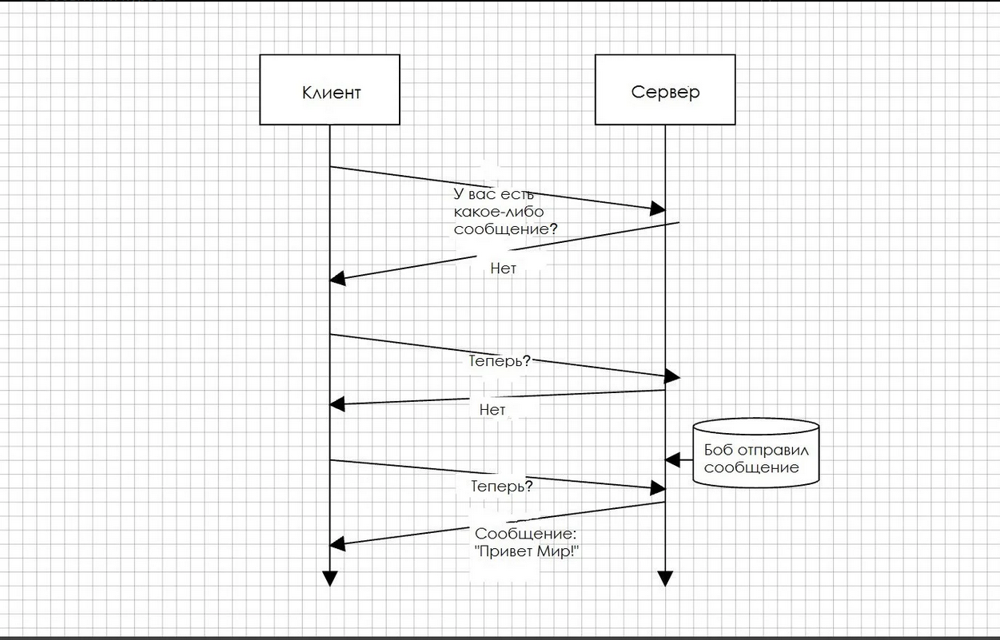
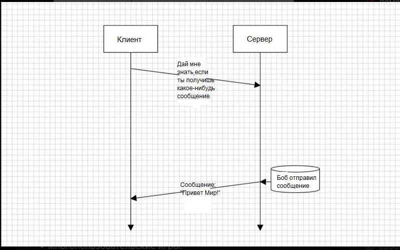

# WebSockets

#### Links

- [Asynchronous web, or what WebSockets are](https://tproger.ru/translations/what-are-web-sockets/)
- [Working with WebSockets in PHP](https://habr.com/ru/post/709448/)
- [HTTP requests and AJAX: short polling, long polling, WebSockets, and everything else](https://vk.com/@social_it-http-zaprosy-i-ajax-short-polling-long-polling-websockets-i)

## Overview [&uarr;](#websockets)

WebSockets are a modern technology that creates an interactive, real-time connection between a client (browser) and a
server. Unlike HTTP, WebSockets enable a bidirectional data stream, which makes this technology unique.

### How HTTP Works

The browser repeatedly asks the server whether there are new messages and receives them.

### How WebSockets Work

With WebSockets, you do not need repeated requests. One request is enough, and then you simply listen to the server as
it pushes messages when they are ready.

WebSockets are useful if you are building:

    real-time applications,
    chat applications,
    IoT applications,
    multiplayer games.

### When to Avoid WebSockets

    Almost never. The main downside is incompatibility with some browsers, but about 95% of browsers already support
    WebSockets.

    In some cases, you might not need WebSockets. If you are building a simple CMS, real-time features are unlikely to
    be necessary.

    WebSockets are also not a good fit for REST APIs, where standard HTTP methods like GET, POST, DELETE, and PUT are
    sufficient.

### HTTP Equivalent

    Since HTTP must constantly check for new messages, you can use a "dirty check" approach where the client polls the
    server at a fixed interval (for example, every 200 ms).

    If you do not want to deal with XMLHttpRequest, you can use Axios. It is declarative and easy to understand.
